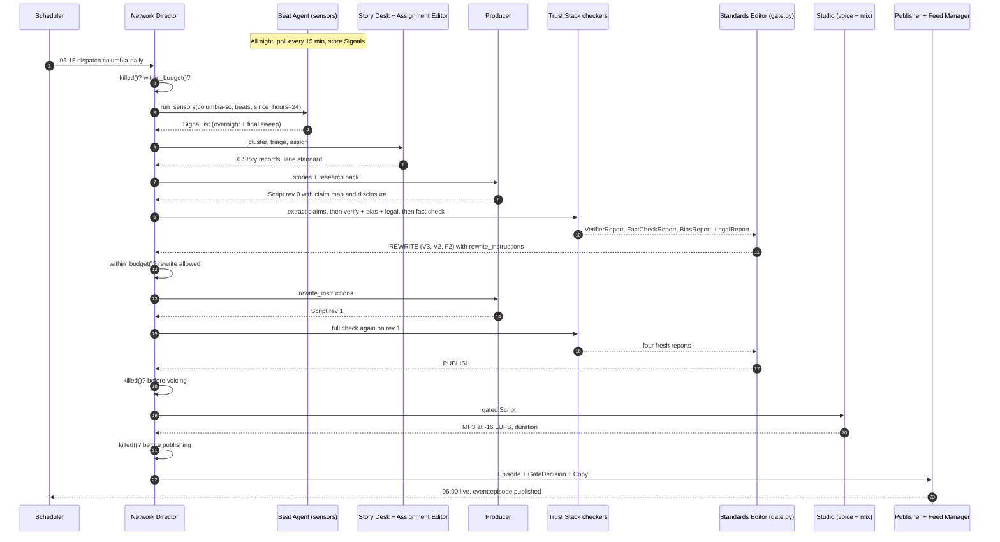
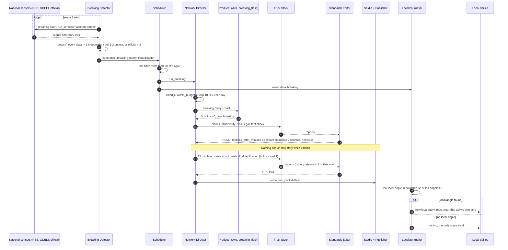

# How it works: the actual workflow

**Project Earlobe** · Curious & Creative LLC (Joshua German, Janel Moore) · v1.0, October 11, 2026

> Joshua asked: **"What's the actual workflow they end up doing?"** This page answers that question concretely. It
> covers the four kinds of loops the agents run, then follows eight real workflows step by step. Each step gives
> the clock time, the agent, the engine module and the exact JSON handed to the next step.

---

## The short answer

- **Nobody types "go."** The network runs four kinds of loops, around the clock:
  **(A)** listeners that never stop, **(B)** shows that run on a schedule, **(C)** shows and fixes that fire
  when something happens, and **(D)** business work that runs daily, weekly and monthly.
- **Listening and publishing are separate jobs.** Sensors watch news feeds, press releases, court dockets and
  public records all day and save what they find as `Signal` records. Sensors never publish. A show
  publishes only when its slot comes up (Columbia Daily at 06:00) or when a trigger fires (a breaking event, a
  court development).
- **Every episode follows the same path,** whatever the show: *sense → cluster → assign → research → write →
  check → decide → voice → publish → keep checking*. One team of agents writes. A separate team checks every
  claim, and the Source Verifier does it blind, without seeing the writer's sources. Plain code
  ([`earlobe/trust/gate.py`](../../earlobe/trust/gate.py)) makes the publish decision. A model never makes it.
- **The gate has four answers.** PUBLISH goes to the studio. REWRITE goes back to the writer with exact fix
  instructions (at most two times). HOLD (breaking news only) waits 15 minutes and checks again. KILL means
  the episode doesn't air, and the reason is logged.
- **Publishing is not the end.** For seven days after air, the Re-check Monitor re-verifies what we said. When
  the facts move, the Corrections Agent fixes the show notes, the feed and, if needed, the audio, and logs the fix
  publicly.
- **You two never approve episodes.** You get one brief at 07:00 ET. It covers what shipped, what was
  stopped and why, the money, and the few yes/no decisions only you can make. You can stop any show
  instantly, but nobody can push an episode past the gate.

## How to read this page

- **Status tags** follow [Convention 9](../CONVENTIONS.md): **built** (in the v1 engine), **next** (next build wave),
  **future** (designed, not scheduled). Steps run by a `next` agent are marked, so this page never claims more
  than the code does. "Built" means the module is in the v1 module map in
  [`earlobe/README.md`](../../earlobe/README.md). As of this writing, `pipeline.py`, `producer/`, `studio/`,
  `publish/` and `monitor/` are still landing. See the status note in the [agent catalog](agent-catalog.md).
- **Agent ids** (`beat-agent`, `source-verifier` and so on) are the ids in the [agent catalog](agent-catalog.md),
  where each one has a full entry.
- **JSON examples use the real field names** from [`earlobe/schemas.py`](../../earlobe/schemas.py) (human
  version: [`json-contracts.md`](json-contracts.md)). They are trimmed to the parts that matter. Shapes marked
  *(proposed)* are not in `schemas.py` yet. Per Convention 8, each one is added to `schemas.py` and
  `json-contracts.md` together when its agent is built.
- **The stories in the examples are fictional.** They are the `[SAMPLE]` events in
  [`earlobe/fixtures.py`](../../earlobe/fixtures.py), the same ones a dry run produces. Nothing here is real news.
- **Times are Eastern (ET)** unless marked PT. Cron expressions in `config/shows.yaml` are UTC. The example day is
  **Tuesday, October 13, 2026**, when the US is still on daylight time.
- **Costs** are rough *(inference)*. They are built from the step sizes in
  [`finance/cost-model.xlsx`](../../finance/) and the price table in
  [`earlobe/config.py`](../../earlobe/config.py). List prices are as of Oct 2026. Verify them before buying.

---

## The network's day at a glance

One weekday in the test markets, Tuesday, October 13, 2026. Loop kinds are explained in the next section.

| ET | PT | What fires | Agent(s) | Loop |
|---|---|---|---|---|
| all day | all day | Market sweeps every 15 min (Columbia, LA, national) | `beat-agent` (+ `press-release-watcher`, next) | A |
| all day | all day | Breaking scan every 5 min | `breaking-detector`, `story-desk` | A |
| court hours | court hours | Docket checks every 30 min on court days | `court-watch` (+ `case-development-watcher`, next) | A |
| every 30 min | | Vendor quota check *(next)* | `quota-sentinel` | D |
| :15 every hour | | Did every episode reach every app? *(next)* | `directory-sync-checker` | D |
| 04:00 | 01:00 | Re-check last 7 days of claims (`recheck --days 7`) | `recheck-monitor` | A |
| 05:00 | 02:00 | Cold Case Files release (Tue/Thu). History of Hollywood release (Mon/Wed/Fri) | evergreen pipeline | B |
| 05:00 | 02:00 | Follow-up tickler: today's hearings, votes, deadlines *(next)* | `follow-up-editor` | D |
| **05:15** | 02:15 | **Columbia Daily run starts** | `network-director` + the episode team | B |
| **06:00** | 03:00 | **Columbia Daily live**. Analytics ingest *(next)* | `publisher`, `analytics-insights` | B, D |
| 07:00 | 04:00 | Ops digest, then the **founders' brief** *(next)* | `run-auditor` → `chief-of-staff` | D |
| 08:00 | 05:00 | Daily cost rollup *(next)* | `finance-reporter` | D |
| 08:15 | **05:15** | **LA Daily run starts** | `network-director` + the episode team | B |
| 09:00 | **06:00** | **LA Daily live**. Charts and reviews check *(next)* | `publisher`, `charts-reviews-monitor` | B, D |
| Fri 10:00 | Fri 07:00 | Case Tracker weekly | episode team, strict lane | B |
| 21:00 | **18:00** | **LA Courts Roundup** | episode team, strict lane | B |
| any time | any time | Breaking Desk flashes, case flashes, corrections, launches, leads | per event | C |

**Daylight saving warning.** The crons in `shows.yaml` are fixed UTC. On **Nov 1, 2026** clocks fall back, and
every show would start landing an hour early in local time. Columbia Daily would land at 05:00 EST. The
Scheduler (`scheduler`, next, wave N1) fixes this by computing UTC from each show's `local_time` and `tz`.
Related: `la-courts` says `local_time: "17:00 (prev day)"`, but its cron (`0 1 * * 2-6`) lands at **18:00 PDT**
today and 17:00 PST after Nov 1. The Scheduler will pin it to one local time.

---

## The four kinds of loops

| Kind | What starts it | What it produces | Publishes? | Examples |
|---|---|---|---|---|
| **A. Always-on** | A timer (every 5, 15 or 30 min, or daily) | `Signal` records, flags, `Correction`s | Never directly | Beat sweeps, Court Watch, breaking scan, Story Desk national scan, Re-check Monitor |
| **B. Scheduled production** | A show's cron in `config/shows.yaml` | One `Episode` | Yes, if the gate says PUBLISH | Columbia Daily, LA Daily, LA Courts, Case Tracker weekly, Cold Case Files, History of Hollywood |
| **C. Event-triggered** | An event on the bus (`event:desk.breaking`, `event:case.development`...) | A flash `Episode`, a fix or a new show | Yes, same gate | Breaking Desk flash, Case Tracker flash, corrections, show launch |
| **D. Business** | Daily, weekly or monthly crons | Briefs, plans, leads, invoices, reports | No audio | Founders' brief, growth plan, sponsor prospecting, finance close, industry intel |

### A. Always-on loops: the network's ears

These loops never publish. They feed the store ([`earlobe/store.py`](../../earlobe/store.py)) so that when a
show's slot arrives, the material is already there.

| Loop | Cadence | Agent | Module | What it saves |
|---|---|---|---|---|
| Market sweep | every 15 min, one instance per market | `beat-agent` (built) | [`sensors/__init__.py`](../../earlobe/sensors/__init__.py) `run_sensors()` → `rss.py`, `press.py`, `gnews.py` (+ `gdelt.py` for national) | `Signal` |
| Official releases | every 15 min | `press-release-watcher` (next). v1 poller is `sensors/press.py` `poll_press()` | `press.py` | `Signal` (`kind: press_release`, tier 1) |
| Courts | every 30 min on court days | `court-watch` (built for federal) | [`sensors/courtlistener.py`](../../earlobe/sensors/courtlistener.py) `recent_dockets()` | `Signal` (`kind: court_record`, tier 1) |
| Tracked cases | every 30 min | `case-development-watcher` (next) | — | `Signal`, `event:case.development` |
| Breaking scan | every 5 min | `breaking-detector` (built, code only) + `story-desk` | [`desk/breaking.py`](../../earlobe/desk/breaking.py) `detect()`, CLI `breaking-scan` | `Story` with `breaking: true`, `event:desk.breaking` |
| Weather and hazards | alerts every 5 min | `weather-hazard-watcher` (next) | — | `Signal` (`official_data`) |
| Social | always-on | `social-signal-watcher` (next) | — | tier-4 `Signal` (a lead, never proof) |
| Injection screen | inline on every ingest | `security-sentinel` (next) | — | quarantine list |
| After-air re-check | daily 04:00 ET (`0 8 * * *` UTC), more often for breaking and strict claims in the first 48 h | `recheck-monitor` (built) | [`monitor/recheck.py`](../../earlobe/monitor/) `recheck(store, llm, days=7)` | `Correction` |

**Cost:** low. Feeds, GDELT and CourtListener are free to read (verify terms as of Oct 2026). Only the
classification passes call a model, on the Haiku tier. The Re-check Monitor is the exception: it re-verifies
claims on the Opus tier with web search (see the [cost table](#what-a-run-costs-rough)).

### B. Scheduled production runs: the shows

Each show's cadence lives in [`config/shows.yaml`](../../config/shows.yaml). When the slot arrives,
`network-director` runs `pipeline.run_show(show_id)` (or `run_evergreen(show_id)` for the evergreen shows).

| Show | Cron (UTC) | Local slot | Lane | Hosts | Length |
|---|---|---|---|---|---|
| `columbia-daily` | `0 10 * * 1-5` | Mon-Fri 06:00 ET | standard | Mara, Theo | 6-8 min |
| `la-daily` | `0 13 * * 1-5` | Mon-Fri 06:00 PT | standard | Lena, Marcus | 6-8 min |
| `la-courts` | `0 1 * * 2-6` | Mon-Fri evening PT | strict | June | 8-12 min |
| `case-tracker` | `0 14 * * 5` | Fri 10:00 ET (+ flashes) | strict | June, Theo | 15-25 min |
| `cold-case-files` | `0 9 * * 2,4` | Tue/Thu 05:00 ET | strict | June | 18-25 min |
| `history-of-hollywood` | `0 9 * * 1,3,5` | Mon/Wed/Fri 02:00 PT | archive | Lena | 15-20 min |
| `nyc-daily`, `chicago-daily` | `0 10`, `0 11` Mon-Fri | 06:00 local | standard | (configured) | wave 1, `enabled: false` |

**Today vs. with the Scheduler.** In v1, a GitHub Actions cron fires *at* the slot time and the episode lands
when the run finishes, roughly 20-45 minutes later *(inference)*. The Scheduler (`scheduler`, next) starts the
run **45 minutes before the slot** *(proposed lead time)*, so the episode is published *at* 06:00.

### C. Event-triggered runs: when something happens

| Event | Fired by | Starts | Guard rails |
|---|---|---|---|
| `event:desk.breaking` | `breaking-detector` | A Breaking Desk flash (`pipeline.run_breaking`). The `localizer` checks each market (next) | `min_gap_minutes: 30`, breaking lane, HOLD instead of guessing |
| `event:case.development` | `case-development-watcher` (next) | A Case Tracker flash (`flash_on: "case.development"` in `shows.yaml`) | strict lane, primary record required |
| `event:correction.opened` | `recheck-monitor`, `community-manager`, outlets | `corrections-agent` | note / reissue / retract rules |
| `event:episode.published` | `publisher` | Growth fan-out: clips, social, newsletter, website, YouTube | gated content only |
| `event:show.greenlit` / `event:market.launch` | `programming-director` | `show-launcher` / `market-launch-marketer` | Release Guard dry run before `enabled: true` |
| `event:run.failed`, `run.anomaly`, `quota.low`, `security.alert` | command desk | `incident-commander` | skip the slot rather than publish something degraded |
| `event:lead.inbound` / `event:lead.services` | inbox, website | `sponsor-prospector` / `services-intake` | founders take the calls |
| `event:legal.threat` | inbox | `contracts-ip-clerk` → founders within the hour | human decision |

### D. Business loops: running the company

| When | What | Agent (tier) |
|---|---|---|
| Daily 06:00 ET | Pull listening data from the host, Apple, Spotify, YouTube, newsletter and social | `analytics-insights` (Sonnet) |
| Daily 07:00 ET | Ops digest (code + Haiku), then the founders' brief: published, stopped, trust, money, decisions | `run-auditor` (Haiku), `chief-of-staff` (Sonnet) |
| Daily 08:00 ET | Spend by show, desk and agent, from every `AgentRun` | `finance-reporter` (Sonnet) |
| Daily 09:00 ET | Chart positions and reviews | `charts-reviews-monitor` (Haiku) |
| Daily | Industry scan, starting with Liquid Studios. Opus-tier synthesis weekly | `industry-intel` (Sonnet / Opus) |
| Mon | Programming memo: launch, grow, change or end shows | `programming-director` (Opus) |
| Mon | Growth plan and experiment backlog | `audience-growth-strategist` (Sonnet) |
| Weekly | Cross-promo schedule, title-test learnings, sponsor prospecting per market, revenue memo, grants, vendor price check | `cross-promo-planner`, `headline-tester`, `sponsor-prospector`, `revenue-director`, `grants-scout`, `vendor-pricing-watch` |
| Sun | Founder memo for the week | `chief-of-staff` |
| Monthly, 1st | Public transparency report from the trust log | `transparency-reporter` (Sonnet) |
| Monthly, 2nd | Media kits and sales deck refresh | `media-kit-builder` (Sonnet) |
| Monthly, by business day 5 | Close pack: P&L by product, unit economics per show, runway | `finance-reporter` |

All of D is `next`. Today these jobs are done by hand or not at all, which is why wave N1 starts with the
`chief-of-staff`.

---

## The spine: what every episode goes through

Every production run, scheduled or event-triggered, walks this path. Only the lane, the format and the inputs
change. `network-director` wires the steps together. It makes no editorial calls of its own.

| # | Step | Agent | Module | Tier | Hands off |
|---|---|---|---|---|---|
| 0 | Safety checks: killed? over budget? | `kill-switch`, `budget-controller` | `monitor/killswitch.py` `killed()`, `monitor/budget.py` `within_budget()` | none | allow / skip |
| 1 | Final sweep for this market and beats | `beat-agent`, `court-watch` | `sensors/__init__.py` `run_sensors()` | none (Sonnet beat memo next) | `Signal[]` |
| 2 | Group duplicates into stories, score them | `story-desk` | `desk/cluster.py` `cluster()`, `desk/score.py` `triage()` | Haiku | `Story[]` (via `StoryTriage`) |
| 3 | Pick this show's stories and lane | `assignment-editor` | `desk/assign.py` `assign()`, `lane_for()` | none | `{show_id: [Story]}` + lane |
| 4 | Background and primary records | `researcher` (next). v1: `build_pack()` | `producer/research_pack.py` | Opus (next) | research pack dict (`ResearchPack`, proposed) |
| 5 | Write the script with a claim map | `producer` | `producer/writer.py` `write_script()` | Opus | `Script` |
| 6 | Line-edit for the ear *(next)* | `copy-editor` | — | Sonnet | `Script` |
| 7 | Append the AI disclosure outro | `disclosure-agent` | `producer/disclosure.py` `ensure_disclosure()` | none | `Script` |
| 8 | List every checkable claim, including unmapped ones | `claim-extractor` | `trust/claims.py` `extract_claims()` | Opus | `Script` (full `claims`) |
| 9 | Check in isolation, side by side | `source-verifier` (blind), `bias-checker`, `legal-screener` (+ `harm-sensitivity-reviewer`, `originality-checker`, next) | `trust/verifier.py`, `bias.py`, `legal.py` | Opus | `VerifierReport`, `BiasReport`, `LegalReport` |
| 10 | Check each claim's wording against the evidence | `fact-checker` | `trust/factcheck.py` `fact_check()` | Opus | `FactCheckReport` |
| 11 | Decide with fixed rules | `standards-editor` | `trust/gate.py` `decide()`, looped by `trust/loop.py` `run_trust_loop()` | none | `GateDecision` |
| 12 | Title, description, show notes, social copy | `copywriter` | `producer/copywriter.py` `write_copy()` | Sonnet | `Copy` |
| 13 | Voice every line | `studio-voice` (+ `pronunciation-keeper`, next) | `studio/tts.py` | none (ElevenLabs) | audio per line |
| 14 | Mix, music, loudness to -16 LUFS | `sound-designer` | `studio/mix.py` `render()` | none | MP3 path + `duration_sec` |
| 15 | Listen back *(next)* | `qa-listener` | — | Haiku | `QAReport` (proposed): PASS / RERENDER / FAIL |
| 16 | Upload, notes, trust log | `publisher` | `publish/hosts.py`, `notes.py`, `trustlog.py` | none | `Episode` + trust log line |
| 17 | Rebuild the RSS feed | `feed-manager` | `publish/feed.py` `write_feed()` | none | RSS with AI disclosure in metadata |
| 18 | Keep checking for 7 days | `recheck-monitor` → `corrections-agent` | `monitor/recheck.py`, `monitor/corrections.py` | Opus / Sonnet | `Correction` |

Three rules hold at every step:

1. **Every model call is logged** in an `AgentRun` envelope (tier, tokens, searches, `usd_estimate`). The budget
   check adds these up for the show's day.
2. **The Kill Switch is checked at stage boundaries:** before sensing, before voicing and before publishing. A
   kill set mid-run still stops the episode.
3. **Fail closed.** If any checker errors, refuses or returns bad JSON, `run_trust_loop` raises and nothing
   publishes (see the docstring in [`trust/loop.py`](../../earlobe/trust/loop.py)).

---

## 1. A day in the life of Columbia Daily

### In plain words

All night, the Columbia Beat Agent reads every Columbia news feed and official release every 15 minutes. At
05:15 the run starts. Duplicates collapse into six stories. Mara and Theo's script is written, then checked claim
by claim. In this example, the first draft fails twice: it states a dollar figure only one outlet reported, and
it contains a "fact" the writer made up. The gate sends exact fix instructions back. The second draft passes. It's voiced, mixed and
live at 06:00. Nobody touched it.

### The sequence



### Step by step, with the contract at each hand-off

Tuesday, October 13, 2026. Times ET (UTC in the JSON). Durations are targets *(inference)* until run logs give
real numbers.

| Time | What happens | Agent | Module / tier | Contract handed on |
|---|---|---|---|---|
| Mon 21:00 → Tue 05:00 | Sweeps every 15 min: The State, WIS, WLTX, Post and Courier, SC Daily Gazette, City of Columbia, Richland County and NWS feeds, plus one Google News search per beat | `beat-agent` | `run_sensors()`. Polling is code | `Signal` |
| 05:00 | Beat memo: what's moving, what's scheduled today *(next)* | `beat-agent` | Sonnet | beat memo |
| 05:15 | Dispatch | `scheduler` (next). v1: cron | — | run request |
| 05:15 | `killed("columbia-daily")` → false. `within_budget()` → $0.00 of $5.00 spent today | `kill-switch`, `budget-controller` | code | allow |
| 05:16 | Final sweep, last 24 h, deduped by URL | `beat-agent` | `run_sensors("columbia-sc", beats, since_hours=24)` | `Signal[]` (example below) |
| 05:17 | 13 Signals become 6 Stories. Wire copies collapse. Each story is scored for this show | `story-desk` | `cluster()` + `triage()`, Haiku | `Story[]` |
| 05:18 | Top 6 stories routed to Columbia Daily. No crime or court flags, so the lane stays `standard` | `assignment-editor` | `assign()`, `lane_for()` | `{"columbia-daily": [...]}` |
| 05:18 | Research pack from each story's sources | `researcher` (next) / `build_pack()` | Opus (next) | research pack dict |
| 05:19 | Script rev 0: cold open, 6 stories, kicker | `producer` | `write_script()`, Opus | `Script` rev 0 |
| 05:23 | Disclosure outro appended, voiced by Ava | `disclosure-agent` | `ensure_disclosure()` | `Script` |
| 05:24 | Claim pass finds one claim the writer didn't map | `claim-extractor` | `extract_claims()`, Opus | `Script` (14 claims) |
| 05:25 | Verifier (blind, up to 20 web searches), bias and legal checks run side by side | `source-verifier`, `bias-checker`, `legal-screener` | Opus, isolated calls | 3 reports |
| 05:31 | Fact check against the verifier's evidence | `fact-checker` | Opus | `FactCheckReport` |
| 05:32 | **REWRITE**: V3 on the dollar figure, V2 + F2 on the made-up line | `standards-editor` | `decide()`, code | `GateDecision` |
| 05:32 | Budget check: about $2.05 of $5.00 spent → rewrite allowed | `budget-controller` | code | allow |
| 05:33 | Rev 1: attribute the figure, cut the invented line | `producer` | `write_script(revision=1, instructions=...)` | `Script` rev 1 |
| 05:35 | Full trust pass again, every checker fresh | trust desk | Opus | 4 reports |
| 05:43 | **PUBLISH** | `standards-editor` | code | `GateDecision` |
| 05:43 | Kill switch check before voicing | `kill-switch` | code | allow |
| 05:44 | Title, description, notes, social posts | `copywriter` | `write_copy()`, Sonnet | `Copy` |
| 05:44 | Local names marked for the voice engine *(next)* | `pronunciation-keeper` | Haiku | lexicon markup |
| 05:45 | About 7,000 characters voiced line by line (Mara, Theo, Ava) | `studio-voice` | `studio/tts.py`, ElevenLabs | audio per line |
| 05:50 | Concatenate, music bed, loudness -16 LUFS | `sound-designer` | `studio/mix.py` `render()` | MP3 + `duration_sec` |
| 05:52 | Listen-back: word errors, silences, levels, disclosure audible *(next)* | `qa-listener` | Haiku + ffmpeg | `QAReport` (proposed) |
| 05:54 | Kill switch check before publishing | `kill-switch` | code | allow |
| 05:55 | Upload, show notes with sources and verification summary, trust log line | `publisher` | `hosts.py`, `notes.py`, `trustlog.py` | `Episode` |
| 05:56 | Feed rebuilt with the disclosure in item metadata | `feed-manager` | `feed.py` | RSS |
| **06:00** | **Live.** Released at the slot (host scheduling or a hold until 06:00; verify the host API) | `publisher` | — | `event:episode.published` |
| 06:15 | Apple, Spotify, YouTube, Amazon, Podcast Index checked *(next)* | `directory-sync-checker` | code | sync status |
| 06:30 | Morning newsletter, social posts, clips *(next)* | growth desk | Sonnet | see [§7](#7-the-growth-and-marketing-loop) |

**① Signal**, from a sensor. This one is the City's own release, so it is tier 1:

```json
{
  "id": "sig_4f1c2a9e0b7d",
  "sensor": "press-columbia-sc",
  "market": "columbia-sc",
  "beat": "government",
  "title": "[SAMPLE] City Council approves Riverbend Park budget amendment, 5-2 vote",
  "url": "https://sample.invalid/columbia/riverbend-amendment",
  "outlet": "City of Columbia",
  "published_at": "2026-10-13T00:50:00Z",
  "summary": "Council moved funds into the Riverbend Park project on a 5-2 vote; a second reading is next month.",
  "kind": "press_release",
  "tier": 1,
  "raw": {"sample": true}
}
```

**② Story**, from the Story Desk. Three outlets carried the bridge story, but The State ran AP's copy. It
collapses into AP, so it counts as **2 independent outlets, not 3**. This is the wire-copy rule in
[`desk/independence.py`](../../earlobe/desk/independence.py), with owner groups from
[`config/owners.yaml`](../../config/owners.yaml).

```json
{
  "id": "sty_9a0e51c7d2b3",
  "market": "columbia-sc",
  "beat": "public_safety",
  "headline": "[SAMPLE] Elm Street Bridge closed after inspectors find structural crack",
  "summary": "Inspectors found a crack in a support beam of the Elm Street Bridge; it is closed while engineers assess repairs.",
  "first_seen": "2026-10-13T07:40:00Z",
  "signal_ids": ["sig_1b77c0d2e4a1", "sig_2c8e91f3a5b2", "sig_3d9fa204b6c3"],
  "source_ids": ["src_6a1e0f9c2d34", "src_7b2f1a0d3e45", "src_8c3a2b1e4f56"],
  "outlets": ["Associated Press", "The State", "WLTX"],
  "independent_outlets": 2,
  "official_confirmation": false,
  "newsworthiness": 78,
  "velocity": 2.0,
  "breaking": false,
  "risk_flags": [],
  "entities": ["Elm Street Bridge"],
  "assigned_shows": ["columbia-daily"]
}
```

**③ Assignment**, from the Assignment Editor. It returns story lists per show, and `lane_for()` picks the lane.
If any of the six stories had carried a `crime`, `legal_proceeding`, `minor` or `victim` flag, the whole episode
would have moved up to the **strict** lane.

```json
{
  "columbia-daily": ["sty_c41d…", "sty_9a0e51c7d2b3", "sty_e7a2…", "sty_0b5f…", "sty_5d13…", "sty_88f0…"],
  "la-daily": [],
  "breaking-desk": [],
  "la-courts": []
}
```

**④ Script rev 0**, from the Producer, trimmed to the lines that matter. Every body line points at its claims.
The writer forgot to map the last sentence of `ln_09`.

```json
{
  "id": "scr_3e8a0c1f6b2d",
  "show_id": "columbia-daily",
  "episode_date": "2026-10-13",
  "title": "Riverbend money, a closed bridge and a soggy weekend",
  "lines": [
    {"id": "ln_01", "speaker": "mara", "text": "Good morning, Columbia. It's Tuesday, October 13th. I'm Mara.", "claim_ids": [], "segment": "intro"},
    {"id": "ln_02", "speaker": "theo", "text": "And I'm Theo. First up: City Council voted 5 to 2 last night to move money into the Riverbend Park project.", "claim_ids": ["clm_1"], "segment": "body"},
    {"id": "ln_03", "speaker": "mara", "text": "The amendment moves $2.4 million into the project. A second reading comes next month.", "claim_ids": ["clm_2", "clm_3"], "segment": "body"},
    {"id": "ln_09", "speaker": "theo", "text": "The Elm Street Bridge is closed after inspectors found a crack in a support beam. It's the second time this year the bridge has been closed for repairs.", "claim_ids": ["clm_8"], "segment": "body"},
    {"id": "ln_31", "speaker": "ava", "text": "This episode was written and voiced using AI. The voices you heard are synthetic, not real people. Facts were checked by automated systems against independent sources. Sources and corrections are in the show notes. Columbia Daily is published by Curious and Creative LLC.", "claim_ids": [], "segment": "disclosure"}
  ],
  "claims": [
    {"id": "clm_1", "text": "City Council voted 5 to 2 to move money into the Riverbend Park project.", "type": "fact", "line_ids": ["ln_02"], "source_ids": ["src_a1c09e7f2b10", "src_b2d1af803c21"], "entities": ["Columbia City Council"], "risk_flags": [], "attributed": false},
    {"id": "clm_2", "text": "The amendment moves $2.4 million into the project.", "type": "number", "line_ids": ["ln_03"], "source_ids": ["src_c3e2b0914d32"], "entities": [], "risk_flags": [], "attributed": false},
    {"id": "clm_8", "text": "The Elm Street Bridge is closed after inspectors found a crack in a support beam.", "type": "fact", "line_ids": ["ln_09"], "source_ids": ["src_6a1e0f9c2d34", "src_8c3a2b1e4f56"], "entities": ["Elm Street Bridge"], "risk_flags": [], "attributed": false}
  ],
  "sources": [],
  "story_ids": ["sty_c41d…", "sty_9a0e51c7d2b3"],
  "lane_policy": "standard",
  "revision": 0,
  "notes_for_checkers": ""
}
```

**⑤ Claim Extractor** output: the same `Script`, with the missing claim added. It gets a new id and **empty
`source_ids`**, so the verifier has to find support from scratch:

```json
{"id": "clm_5d0b8e2a71c4", "text": "It's the second time this year the bridge has been closed for repairs.", "type": "fact", "line_ids": ["ln_09"], "source_ids": [], "entities": ["Elm Street Bridge"], "risk_flags": [], "attributed": false}
```

**⑥ VerifierReport**, from the blind Source Verifier. It never saw the writer's sources. It searched on its own,
and `independent_count` is recomputed in code from owner groups.

```json
{
  "script_id": "scr_3e8a0c1f6b2d",
  "findings": [
    {"claim_id": "clm_1", "status": "corroborated", "independent_count": 4, "has_official": true, "traced_to_original": true,
     "evidence": [
       {"url": "https://sample.invalid/columbia/riverbend-amendment", "outlet": "City of Columbia", "tier": 1, "owner_group": "City of Columbia", "supports": true, "note": "Official release states the 5-2 vote."},
       {"url": "https://sample.invalid/wis/riverbend", "outlet": "WIS", "tier": 2, "owner_group": "Gray Media", "supports": true, "note": ""},
       {"url": "https://sample.invalid/thestate/riverbend", "outlet": "The State", "tier": 2, "owner_group": "McClatchy", "supports": true, "note": ""},
       {"url": "https://sample.invalid/scdg/riverbend", "outlet": "SC Daily Gazette", "tier": 3, "owner_group": "States Newsroom", "supports": true, "note": ""}],
     "note": ""},
    {"claim_id": "clm_2", "status": "single_source", "independent_count": 1, "has_official": false, "traced_to_original": true,
     "evidence": [{"url": "https://sample.invalid/thestate/riverbend", "outlet": "The State", "tier": 2, "owner_group": "McClatchy", "supports": true, "note": "Only report with a dollar figure; the city release gives none."}],
     "note": "No second independent source for $2.4 million."},
    {"claim_id": "clm_8", "status": "corroborated", "independent_count": 2, "has_official": false, "traced_to_original": true,
     "evidence": [
       {"url": "https://sample.invalid/ap/elm-street-bridge", "outlet": "Associated Press", "tier": 2, "owner_group": "Associated Press", "supports": true, "note": "Original wire story."},
       {"url": "https://sample.invalid/wltx/elm-street-bridge", "outlet": "WLTX", "tier": 2, "owner_group": "TEGNA", "supports": true, "note": "The State's version is AP copy, counted once as AP."}],
     "note": ""},
    {"claim_id": "clm_5d0b8e2a71c4", "status": "unsupported", "independent_count": 0, "has_official": false, "traced_to_original": false, "evidence": [], "note": "No record of an earlier 2026 closure found."}
  ],
  "searches_used": 17
}
```

**⑦ The other three reports**, each from its own isolated call:

```json
{"script_id": "scr_3e8a0c1f6b2d", "findings": [
  {"claim_id": "clm_1", "rating": "accurate", "issue": "", "suggested_fix": ""},
  {"claim_id": "clm_2", "rating": "accurate", "issue": "", "suggested_fix": ""},
  {"claim_id": "clm_5d0b8e2a71c4", "rating": "unverifiable", "issue": "No evidence of an earlier closure this year.", "suggested_fix": "Cut the sentence."}]}
```

```json
{"script_id": "scr_3e8a0c1f6b2d", "balance_score": 88, "issues": [
  {"line_id": "ln_03", "type": "framing", "severity": "low", "explanation": "Leads with the cost before what the project is.", "suggestion": "Say what Riverbend Park is first."}],
  "missing_perspectives": []}
```

```json
{"script_id": "scr_3e8a0c1f6b2d", "issues": []}
```

These are the `FactCheckReport`, `BiasReport` and `LegalReport`. A low-severity bias note is logged but doesn't
block. Only high severity (`B2`) or a balance score under the lane minimum (`B1`) blocks.

**⑧ GateDecision: REWRITE.** The detail and fix strings are exactly what `gate.decide()` writes:

```json
{
  "script_id": "scr_3e8a0c1f6b2d",
  "decision": "REWRITE",
  "lane_policy": "standard",
  "revision": 0,
  "reasons": [
    {"rule_id": "V3", "detail": "1 independent source(s); policy 'standard' needs 2", "target_id": "clm_2", "blocking": true},
    {"rule_id": "V2", "detail": "no supporting source found", "target_id": "clm_5d0b8e2a71c4", "blocking": true},
    {"rule_id": "F2", "detail": "unverifiable as worded", "target_id": "clm_5d0b8e2a71c4", "blocking": true}
  ],
  "rewrite_instructions": [
    "Find more independent sourcing for clm_2 or cut it: \"The amendment moves $2.4 million into the project.\".",
    "Remove clm_5d0b8e2a71c4: \"It's the second time this year the bridge has been closed for repairs.\" (unsupported).",
    "Remove or soften clm_5d0b8e2a71c4."
  ],
  "scores": {"corroboration_rate": 0.857, "accuracy_rate": 1.0, "balance_score": 88, "claims": 14},
  "recheck_after_minutes": null
}
```

**⑨ Script rev 1.** The Producer changes only what was flagged. The loop, not the writer, sets `revision` and
`lane_policy`, so a rewrite can't reset its own budget or move to an easier lane.

```json
{"id": "ln_03", "speaker": "mara", "text": "The State reports the amendment moves about $2.4 million into the project. A second reading comes next month.", "claim_ids": ["clm_2", "clm_3"], "segment": "body"}
```

```json
{"id": "clm_2", "text": "The State reports the amendment moves about $2.4 million into the project.", "type": "number", "line_ids": ["ln_03"], "source_ids": ["src_c3e2b0914d32"], "entities": ["The State"], "risk_flags": [], "attributed": true}
```

The "second time this year" sentence is gone. Now `clm_2` passes through the standard lane's
**attributed single-source** path: one source is acceptable for a low-risk claim *when the listener hears who
says it*. That path is closed in the strict and breaking lanes.

**⑩ GateDecision: PUBLISH.**

```json
{
  "script_id": "scr_b71d40e9c385",
  "decision": "PUBLISH",
  "lane_policy": "standard",
  "revision": 1,
  "reasons": [],
  "rewrite_instructions": [],
  "scores": {"corroboration_rate": 1.0, "accuracy_rate": 1.0, "balance_score": 90, "claims": 13},
  "recheck_after_minutes": null
}
```

**⑪ Copy**, from the Copywriter. It is written only after PUBLISH, so it can never promise a fact the gate cut.

```json
{
  "title": "Riverbend Park money, Elm Street Bridge closed, flood watch",
  "description": "Columbia City Council moved money into Riverbend Park on a 5-2 vote. The Elm Street Bridge is closed after inspectors found a crack. And a flood watch for the Midlands through Sunday.",
  "show_notes_md": "## Stories\n...\n## Sources\n...\n## How we checked this episode\n...",
  "social_posts": ["Elm Street Bridge is closed while engineers assess a crack in a support beam. What we know, in 7 minutes. (AI-voiced, sources in the notes)"],
  "keywords": ["Columbia SC", "Riverbend Park", "Elm Street Bridge", "Midlands flood watch"]
}
```

**⑫ Episode**, from the Publisher:

```json
{
  "id": "ep_2f7c9a1d0e63",
  "show_id": "columbia-daily",
  "script_id": "scr_b71d40e9c385",
  "title": "Riverbend Park money, Elm Street Bridge closed, flood watch",
  "description": "Columbia City Council moved money into Riverbend Park on a 5-2 vote...",
  "show_notes_md": "...sources, verification summary, AI disclosure...",
  "audio_path": "data/audio/columbia-daily/2026-10-13.mp3",
  "audio_url": "https://host.example.invalid/columbia-daily/2026-10-13.mp3",
  "duration_sec": 431,
  "published_at": "2026-10-13T10:00:00Z",
  "guid": "ep_2f7c9a1d0e63",
  "status": "published",
  "disclosure_text": "This episode was written and voiced using AI...",
  "transcript_path": "",
  "gate": {"decision": "PUBLISH", "lane_policy": "standard", "revision": 1, "scores": {"corroboration_rate": 1.0, "accuracy_rate": 1.0, "balance_score": 90, "claims": 13}},
  "source_count": 14
}
```

**⑬ AgentRun**, one per model call. This one is the first verifier pass. The cost is 150k input tokens × $4/M,
plus 12k output × $20/M, plus 17 searches × $0.01 = $1.01 (`config.estimate_usd`, list prices as of Oct 2026,
verify).

```json
{"agent_id": "source-verifier", "run_id": "run_a90c3e51b7d2", "model_tier": "opus", "started_at": "2026-10-13T09:25:10Z", "finished_at": "2026-10-13T09:30:40Z", "input_tokens": 150000, "output_tokens": 12000, "web_searches": 17, "usd_estimate": 1.01, "ok": true, "error": ""}
```

**⑭ Trust log line**, public JSONL from `publish/trustlog.py` *(proposed shape until the module lands)*:

```json
{"ts": "2026-10-13T09:55:12Z", "show_id": "columbia-daily", "episode_id": "ep_2f7c9a1d0e63", "decision": "PUBLISH", "lane": "standard", "revision": 1, "history": [{"revision": 0, "decision": "REWRITE", "rules": ["V3", "V2", "F2"]}, {"revision": 1, "decision": "PUBLISH", "rules": []}], "scores": {"corroboration_rate": 1.0, "accuracy_rate": 1.0, "balance_score": 90, "claims": 13}}
```

### The rewrite loop, up close

- **Who loops:** `run_trust_loop()` in [`trust/loop.py`](../../earlobe/trust/loop.py). On REWRITE it calls the
  Producer with the gate's `rewrite_instructions`, bumps `revision`, carries the disclosure over if the rewrite
  dropped it, and runs **every** checker again from scratch. Checkers never see their own earlier reports.
- **How many:** the lane's `max_rewrites`. That's 2 for standard, strict and archive, and 1 for breaking. A script still
  blocked after that is **KILL**. `MAX_PASSES = 6` is a second hard stop on spend.
- **Money:** the Budget Controller checks before each rewrite. A Columbia Daily first pass costs about $2 and a
  rewrite about $1.20, so first pass + two rewrites (about $4.40) fits the $5.00 cap *(inference)*. If a rewrite
  would go over, the run stops and logs the reason. The network would rather miss an episode than ship a
  less-checked one.

### When something goes wrong

| What happens | What the system does | What you see |
|---|---|---|
| Gate says KILL (still blocked after 2 rewrites, or a minor or victim named at the last revision) | Nothing airs. The decision and reasons are stored | One line in the 07:00 brief: "Columbia Daily: no episode, reason V1 on the lead story" |
| A checker errors or refuses | Fail closed. The run stops before the studio | Same line, reason "checker error" |
| Budget cap reached | Run skipped, `event:budget.exceeded` | Line in the brief |
| Kill switch set (env `EARLOBE_KILL` or `config/killswitch.yaml`) | Stops at the next stage boundary | Reason written to the trust log |
| TTS fails | `incident-commander` *(next)* retries, then fails over to the backup engine. The slot is skipped if the episode can't be made safely | Status line and postmortem |
| A feed goes dead | `run_sensors()` never raises. Other sensors carry on, and the Beat Agent flags the quiet source | Beat memo note |

---

## 2. A Breaking Desk flash

### In plain words

A breaking scan runs every five minutes. When a big national event shows up at enough independent outlets of
the right kind, inside an hour, the Breaking Detector fires. This is fixed code, not a model guessing. Ava's
flash is written and checked under the strictest rules on the network: three independent sources, and anything
about deaths needs an official record too. If a detail isn't confirmed yet, the gate **holds** the flash for 15
minutes and checks again, rather than airing a rumor. Once confirmed, it's live in minutes. The local dailies
don't change unless a real local angle turns up.

### The sequence



### Step by step

The example is the fictional `[SAMPLE]` hurricane from `fixtures.py`, on Tuesday afternoon, ET.

| Time | What happens | Agent | Contract |
|---|---|---|---|
| 14:22 | National Hurricane Center advisory posts (tier 1, official) | sensor | `Signal` |
| 14:26 / 14:29 | Associated Press, then Reuters (tier 2, different owner groups) | sensor | `Signal` |
| 14:30 | Scan: 3 independent tier 1-2 outlets inside 60 min, an official source among them, and the headline reads as `disaster` → **flagged** | `breaking-detector` (`detect()`, code) | `Story` (`breaking: true`) |
| 14:30 | `event:desk.breaking`. No flash in the last 30 min → dispatch | `scheduler` (next). v1: the breaking-scan job | event *(proposed shape below)* |
| 14:31 | Kill switch and budget checks. Breaking has its own $10/day cap and **still runs after the network-wide $60 cap is hit** | `kill-switch`, `budget-controller` | allow |
| 14:31 | Format: *what we know, what we don't know yet, what happens next* | `showrunner-breaking` (next) | flash rundown |
| 14:32 | Script, about 3 minutes, Ava | `producer` (Opus) | `Script`, `lane_policy: "breaking"` |
| 14:35 | Trust pass | trust desk (Opus) | 4 reports |
| 14:43 | **HOLD**: the death claim has 2 independent sources and no official record | `standards-editor` | `GateDecision` (below) |
| 14:58 | Re-check of the **same script**: the county emergency office has posted a release, and AP also has it now | trust desk | 4 fresh reports |
| 15:05 | **PUBLISH** | `standards-editor` | `GateDecision` |
| 15:06-15:09 | Voice (about 3,000 characters), mix | `studio-voice`, `sound-designer` | MP3 |
| **15:10** | **Live** in the Breaking Desk feed. Social posts only *after* this | `publisher`, `feed-manager` | `Episode` |
| 15:10+ | Localizer finds no Columbia or LA angle → the dailies are untouched | `localizer` (next) | no-angle decision |
| ≥ 15:40 | Next flash on this story allowed (30-min gap). Updates fold into it | `showrunner-breaking` | — |

**Speed:** about **20 minutes from trigger to live when nothing holds**, and about 40 with one hold, as here
*(inference; targets until run logs exist)*.

**Story, flagged breaking.** `detect()` sets `breaking`, replaces `beat` with the event class and adds the
`breaking` risk flag:

```json
{
  "id": "sty_51e0a7c39d24",
  "market": "national",
  "beat": "disaster",
  "headline": "[SAMPLE] Hurricane Sample makes landfall near Cape Marlow as Category 3 storm",
  "summary": "A Category 3 hurricane made landfall near Cape Marlow; forecasters and emergency officials are tracking winds and storm surge.",
  "first_seen": "2026-10-13T18:22:00Z",
  "signal_ids": ["sig_0a1b2c3d4e5f", "sig_1b2c3d4e5f60", "sig_2c3d4e5f6071"],
  "source_ids": ["src_90ab12cd34ef", "src_a1bc23de45f0", "src_b2cd34ef5601"],
  "outlets": ["National Hurricane Center", "Associated Press", "Reuters"],
  "independent_outlets": 3,
  "official_confirmation": true,
  "newsworthiness": 96,
  "velocity": 3.0,
  "breaking": true,
  "risk_flags": ["breaking"],
  "entities": ["Hurricane Sample", "Cape Marlow", "National Hurricane Center"],
  "assigned_shows": ["breaking-desk"]
}
```

**The event** *(proposed shape; the event bus arrives with the Scheduler)*:

```json
{"event": "desk.breaking", "story_id": "sty_51e0a7c39d24", "beat": "disaster", "show_id": "breaking-desk", "fired_at": "2026-10-13T18:30:04Z", "detector": {"independent_tier12_outlets": 3, "official": true, "window_minutes": 60}}
```

**The claim that held it.** The script attributes the claim on air. But breaking-lane rules don't accept
attribution as a substitute for sourcing, and `death` makes the claim sensitive:

```json
{"id": "clm_4", "text": "Officials in Marlow County say at least two people have died.", "type": "fact", "line_ids": ["ln_06"], "source_ids": ["src_c3de45f06712"], "entities": ["Marlow County"], "risk_flags": ["death"], "attributed": true}
```

**GateDecision: HOLD.** Every blocking reason is a "not confirmed enough *yet*" reason (V3 or V4), the lane is
breaking and fewer than 6 holds have been used, so the decision is HOLD, not REWRITE:

```json
{
  "script_id": "scr_7e20c4b1a953",
  "decision": "HOLD",
  "lane_policy": "breaking",
  "revision": 0,
  "reasons": [{"rule_id": "V3", "detail": "2 independent source(s); policy 'breaking' needs 3", "target_id": "clm_4", "blocking": true}],
  "rewrite_instructions": [],
  "scores": {"corroboration_rate": 0.889, "accuracy_rate": 1.0, "balance_score": 92, "claims": 9},
  "recheck_after_minutes": 15
}
```

Fifteen minutes later the caller runs the loop again with `holds_used=1`. The verifier searches fresh, finds the
county's release (tier 1) plus three outlets, and the gate returns **PUBLISH**. If three outlets had confirmed
the deaths but no official record existed yet, the reason would have changed to **V4** ("sensitive claim ... lacks
an official record source"), which is still a HOLD. After **6 holds (90 minutes)** the flash gets its one
rewrite to cut what's unconfirmed. If it's still blocked after that, it's KILLed.

> **Design note.** The gate holds the whole flash, not just the one unconfirmed claim. If speed matters more
> than completeness, the Breaking Desk showrunner should keep unconfirmed details out of the first flash and
> list them under "what we don't know yet." A split mode is a possible future gate change *(proposed)*: publish
> the confirmed core now and save the held claim for the next flash. Each HOLD re-check is a full checker pass
> (about $1.30 *(inference)*), so six holds would use most of the $10 daily cap. That's another reason to
> re-verify only the claims that blocked *(proposed)*.

### Why one big story doesn't flood every show

1. **A high bar to fire.** `detect()` needs a Breaking Desk event class *and* 3 independent tier 1-2 outlets
   inside 60 minutes (or an official source + 2). Syndicated copies count once. A false trigger costs a gated
   episode. A missed one is caught 5 minutes later. So the rules favor precision.
2. **One show takes it.** `assign()` gives breaking stories to the breaking lane only (any market, beat must
   be one of `breaking-desk`'s beats). Every other show needs `story.market == show.market`, and a national
   story's market is `national`. So Columbia Daily and LA Daily never receive it.
3. **Local means local.** The Localizer *(next)* looks for a genuine local connection: a local official's
   on-record response, local data, a local person, employer, base, case or law. If it finds one, it creates a
   *new local Story* that must clear the daily's own lane. If it doesn't, the daily stays about the city. (A
   tornado *in* Columbia is different: it's local news, and `assign()` lets a standard-lane daily take its own
   market's breaking stories.)
4. **One flash per 30 minutes.** `min_gap_minutes: 30` in `shows.yaml`. Updates fold into the next flash. The
   showrunner decides between one flash, a run of updates and an explainer once facts settle.
5. **Nothing airs on rumor.** While a story is on HOLD, nothing about it publishes anywhere. Social posts go
   out only after the episode is live.
6. **Guard rails downstream.** Breaking coverage of deaths and attacks runs **ad-free** by default (`ad-ops`).
   Spin-offs (Sports, Courts, Space, Markets) get *separate feeds* with their own thresholds instead of more
   noise in the main feed. The Quota Sentinel throttles the Breaking Desk last.

---

## 3. LA Courts Roundup and the Case Tracker

### In plain words

Court Watch checks the dockets every 30 minutes on court days. Each evening, June's roundup covers what was
filed, ruled and scheduled. It runs in the **strict lane**: every accusation needs a court record or official
statement, and "accused," "charged" and "has pleaded not guilty" are said out loud. The Case Tracker follows a
short list of cases across every court and agency. A weekly episode covers the best of the last seven days,
and a short flash fires when a case actually moves.

### Court Watch never sleeps (on court days)

| Source | How | Status |
|---|---|---|
| Federal: Central District of California (`cacd`), plus `scotus` | CourtListener v4, `recent_dockets(courts, since_hours=24, token)`, token in `COURTLISTENER_TOKEN` | **built** |
| LA Superior Court (state) | Public case access where the terms allow, cleared first by `compliance-policy-watch` | next |
| LA County DA releases (`da_press` beat) | Official feed via `sensors/press.py` | built (feed URLs still being verified) |
| Classification | New case, ruling, plea, sentencing, hearing set, dismissal. Notable parties flagged | next (Haiku) |
| Intake filter | **Sealed matters, juvenile cases and victim identities are dropped before any writer sees them** | next (rule in the agent file) |

Court records enter as `Signal` with `kind: "court_record"` and `tier: 1`:

```json
{
  "id": "sig_0c4d8e2f6a19",
  "sensor": "courtlistener",
  "market": "los-angeles",
  "beat": "federal_court",
  "title": "[SAMPLE] Docket: Sample v. Example Studios, motion to dismiss granted in part",
  "url": "https://sample.invalid/courtlistener/docket/sample-v-example-studios",
  "outlet": "CourtListener",
  "published_at": "2026-10-13T20:10:00Z",
  "summary": "A federal judge granted in part a motion to dismiss in a studio contract suit.",
  "kind": "court_record",
  "tier": 1,
  "raw": {"court": "cacd", "entry_type": "ruling"}
}
```

### The strict lane, next to the others

From `POLICIES` in [`gate.py`](../../earlobe/trust/gate.py). The full rule text is in
[editorial standards §2 and §16](../standards/editorial-standards.md).

| Setting | standard | **strict** | breaking | archive |
|---|---|---|---|---|
| Independent owner groups per claim | 2 | **2** | 3 | 2 |
| One official record is enough on its own | yes | **yes** | no | yes |
| One source OK if attributed (low-risk claims) | yes | **no** | no | yes |
| Sensitive claims also need an official record | no | **yes** | yes | no |
| Minimum balance score | 70 | **75** | 70 | 65 |
| Legal issues block at | high | **medium** | medium | high |
| Rewrites / holds | 2 / 0 | **2 / 0** | 1 / 6 × 15 min | 2 / 0 |

### LA Courts Roundup, step by step

Mon-Fri, PT. The cron `0 1 * * 2-6` UTC lands at 18:00 PDT, so the roundup is out for the evening.

| Time (PT) | What happens | Agent |
|---|---|---|
| 08:00-17:30 | Dockets checked every 30 min. DA and court press feeds every 15 min | `court-watch`, `beat-agent` |
| 18:00 | Run starts. Kill switch and budget ($6.00/day cap) | `network-director` |
| 18:01 | Cluster and score. `assign()` gives `la-courts` its court-beat stories, **plus** any LA crime story carrying `legal_proceeding` (the strict court match) | `story-desk`, `assignment-editor` |
| 18:02 | Pack: docket entries, filings, prior coverage. Hand-off to Case Tracker if a case qualifies | `researcher` (next), `showrunner-courts` (next) |
| 18:03 | June's script: new filings, rulings, pleas, sentencings, then the week ahead | `producer` (Opus) |
| 18:08 | Trust pass, with the Harm & Sensitivity Reviewer added in strict lanes *(next)* | trust desk |
| 18:15 | **REWRITE** (example below) → rev 1 → **PUBLISH** about 18:30 | `standards-editor`, `producer` |
| ~18:40 | Voiced (about 10,000 characters), mixed, live | studio, `publisher` |

**A typical strict-lane catch.** The `LegalReport` flags a line that treats a charged man as guilty:

```json
{
  "script_id": "scr_e14b9d07c2a8",
  "issues": [
    {"target_id": "ln_12", "risk": "presumption_of_innocence", "severity": "medium",
     "explanation": "Line calls Defendant A 'the man who robbed the store'; he is charged, not convicted.",
     "fix": "Say 'the man accused of robbing the store, who has pleaded not guilty'."}
  ]
}
```

In the standard lane, medium severity would not block. In the strict lane it does (`L1`). The same pass also
catches an allegation backed only by news reports (`V4`):

```json
{
  "script_id": "scr_e14b9d07c2a8",
  "decision": "REWRITE",
  "lane_policy": "strict",
  "revision": 0,
  "reasons": [
    {"rule_id": "V4", "detail": "sensitive claim (allegation/legal status/crime) lacks an official record source", "target_id": "clm_9", "blocking": true},
    {"rule_id": "L1", "detail": "presumption_of_innocence (medium): Line calls Defendant A 'the man who robbed the store'; he is charged, not convicted.", "target_id": "ln_12", "blocking": true}
  ],
  "rewrite_instructions": [
    "Back clm_9 with a court record or official statement, or cut it.",
    "Say 'the man accused of robbing the store, who has pleaded not guilty'."
  ],
  "scores": {"corroboration_rate": 0.917, "accuracy_rate": 1.0, "balance_score": 81, "claims": 12},
  "recheck_after_minutes": null
}
```

Rev 1 cuts `clm_9` ("Police say Defendant A fled in a stolen car", reported by two outlets, with no police
release or filing) and fixes the wording. It publishes. Naming a minor or a victim (`L2`) forces a rewrite that
removes the identifying details, and **KILLs** the episode if it's still there at the last allowed revision.

### Case Tracker: the weekly and the flashes

| Piece | How it works | Status |
|---|---|---|
| Which cases | A short list in `config/cases.yaml` *(proposed)*, picked by written criteria: public interest, official records available, no exploitation of victims | `case-file-keeper` (next) |
| Watching | Each tracked docket, the prosecutor's and police press pages, and news searches, every 30 min. Each hit is classified as a development (charge, plea, ruling, verdict, sentencing, new filing) or noise | `case-development-watcher` (next, Haiku) |
| The file | One `CaseFile` per case: exact legal status, a dated timeline with a primary source per entry, what is alleged vs. what is established, next dates, things that must stay off air | `case-file-keeper` (next, Opus) |
| Flash | A **major** development backed by a primary record → `event:case.development` → a short strict-lane flash, built from the updated `CaseFile` | `showrunner-case-tracker` (next) |
| Weekly | **Fri 10:00 ET** (`0 14 * * 5`): best of the last 7 days, 15-25 min, June and Theo. Minor developments (hearing set, new filing) wait for the weekly | `showrunner-case-tracker`, `producer` |
| v1 today | The weekly runs on its cron from `tracked_cases` docket Signals (CourtListener). **No flashes until the watcher ships (wave N2)** | built pieces only |

**CaseFile** *(proposed)*. The weekly and the flashes both start from it, so they can't contradict each other:

```json
{
  "case_id": "case_state-v-sample",
  "title": "[SAMPLE] State v. Sample",
  "dockets": [{"court": "[SAMPLE] county superior court", "number": "[SAMPLE] CR-0000", "url": "https://sample.invalid/docket/cr-0000"}],
  "parties": [{"name": "[SAMPLE] Defendant B", "role": "defendant", "legal_status": "charged", "status_source_id": "src_d4ef56a07823"}],
  "timeline": [{"date": "2026-10-12", "event": "Pretrial hearing set for next month", "source_id": "src_d4ef56a07823", "established": true}],
  "next_dates": [{"date": "2026-11-16", "what": "pretrial hearing"}],
  "do_not_air": ["Unrecorded rumors about a second suspect"],
  "tip_line": null,
  "updated_at": "2026-10-13T00:40:00Z"
}
```

**The development event** *(proposed)*:

```json
{"event": "case.development", "case_id": "case_state-v-sample", "development": "plea", "signal_id": "sig_5e6f7a8b9c0d", "primary_record_url": "https://sample.invalid/docket/cr-0000/entry/41", "flash": true, "detected_at": "2026-10-20T17:12:00Z"}
```

---

## 4. Cold Case Files and History of Hollywood (evergreen)

### In plain words

Evergreen shows don't chase the clock, so they work differently. Each show plans a season, keeps a queue of
researched episode ideas, and produces episodes **days ahead** using the cheaper batch mode. The scheduled
slot just releases an episode that was already written, checked and voiced. Cold Case Files stays in the strict
lane because it involves real victims and families. History of Hollywood uses the archive lane, which still
needs two independent sources or one primary record but allows a bit more narrative voice.

### The topic queue

| Step | What happens | Agent |
|---|---|---|
| Season plan | 8-12 episodes with an arc. Each episode is outlined as scene, stakes, turn, why it still matters | `showrunner-evergreen` (next, Sonnet) |
| Archive pack (Hollywood) | Library of Congress and Chronicling America, the National Archives, Internet Archive and HathiTrust public-domain texts, Calisphere, the Media History Digital Library. **Rights status on every item** | `archive-miner` (next, Sonnet, weekly per series) |
| Case dossier (Cold Case) | NamUs public data, police and attorney-general cold-case pages, FBI public appeals, newspaper archives. The Charley Project and Doe Network are **leads only**. Favors cases where investigators are publicly asking for tips | `cold-case-archivist` (next, Opus) |
| Queue | Ideas with a ready pack wait in order. The showrunner keeps a buffer of produced episodes *(proposed: 2 weeks)* | `showrunner-evergreen` |

A queue item *(proposed shape)*:

```json
{
  "series": "history-of-hollywood",
  "season": 1,
  "episode": 4,
  "working_title": "[SAMPLE] The night Starlight Pictures' first sound stage went dark",
  "status": "pack_ready",
  "lane": "archive",
  "pack_source_ids": ["src_e5f607a18934", "src_f607a8b29a45"],
  "primary_sources": 7,
  "rights_clear": true,
  "produce_by": "2026-10-20",
  "release_slot": "2026-10-26T09:00:00Z"
}
```

An archive item enters as an ordinary `Source`, with `kind: "archive"`. A primary record is tier 1:

```json
{"id": "src_e5f607a18934", "url": "https://sample.invalid/archive/permit-1928", "outlet": "[SAMPLE] City building permit records", "title": "[SAMPLE] Permit for a sound stage, 1928", "published_at": "1928-03-02T00:00:00Z", "retrieved_at": "2026-10-12T15:04:00Z", "tier": 1, "kind": "archive", "owner_group": "[SAMPLE] City records office", "syndicated_from": "", "excerpt": "Permit issued for a sound stage on the Starlight lot (our summary, not the document's text).", "market": "los-angeles"}
```

Encyclopedias and blogs are tier-4 leads, used only to find primary records. Copyrighted text is never read on
air. The Originality Checker *(next)* enforces that mechanically, flagging any unquoted run over 12 words.

### Producing ahead, at batch prices

- **When:** `run_evergreen(show_id)` produces the next queued episode several days before its slot. It runs the
  full spine: write → check → gate (with rewrites) → voice → mix. The finished episode waits in the store with
  its `GateDecision`.
- **Batch pricing:** time doesn't matter here, so the model calls go through the Message Batches API at
  **50% off token cost** (F-LLM, `BATCH_DISCOUNT = 0.5` in [`config.py`](../../earlobe/config.py); as of Oct 2026,
  verify). Results can take hours, which is fine days ahead. Web-search fees are not discounted, and you should
  verify that server-side search tools run in batch mode. Rough cost per episode *(inference)*: History of Hollywood is about
  $3.60 live or **about $2.00 batched**. Cold Case Files is about $4.40 live or **about $2.40 batched**.
  Prompt caching of the long system prompts saves a bit more.
- **Voice:** long episodes are the biggest TTS users, about 18,000-22,000 characters each (about 1,000 characters
  per minute, F-TTS). Producing ahead lets the Quota Sentinel *(next)* spread them across the month.

### Release day

| Show | Slot | What happens at the slot |
|---|---|---|
| History of Hollywood | Mon/Wed/Fri 02:00 PT (`0 9 * * 1,3,5`) | Kill switch check → Publisher releases the stored episode → feed rebuilt |
| Cold Case Files | Tue/Thu 05:00 ET (`0 9 * * 2,4`) | **Pre-release case-status re-check** *(proposed)*: in the 24 h before release, re-verify the case's legal status (arrest, identification, charges). If it moved, the episode goes back for a rewrite and the next one in the queue takes the slot. Then release, ending with the official tip line |

Cold Case hard rules: never name an uncharged person as a suspect, no graphic detail beyond the official
record, and a sensitivity note for the Harm & Sensitivity Reviewer. Families are not speculated about.

---

## 5. The corrections loop

### In plain words

Every morning at 04:00 ET, the Re-check Monitor goes back over the last week's claims. Charges get dropped, numbers get
revised and votes get reversed. When the record has moved, or a listener or outlet reports an error, a
correction opens. The fix lands in the show notes and the feed. If listeners would rely on the wrong fact,
corrected audio replaces the episode and the next episode says the correction out loud. Every correction is
logged publicly. Nothing is edited silently.

### Step by step

| Time | What happens | Agent | Module | Contract |
|---|---|---|---|---|
| 04:00 daily | `python -m earlobe recheck --days 7`: re-verify published claims (breaking and strict claims more often in their first 48 h, *proposed every 4 h*) | `recheck-monitor` (Opus) | `monitor/recheck.py` `recheck()` | `Correction[]` |
| any time | Listener email or review → triaged as a correction | `community-manager` (next) | — | `Correction` (`reported_by: "listener"`) |
| any time | An earlier story changed, spotted on a follow-up date | `follow-up-editor` (next) | — | alert → recheck |
| on open | `event:correction.opened` | `corrections-agent` (Sonnet) | `monitor/corrections.py` `open_correction()` | `Correction` |
| +minutes | Choose the action: **note**, **reissue** or **retract** (rules in [editorial standards §15](../standards/editorial-standards.md)) | `corrections-agent` | — | `Correction.action` |
| +minutes | `apply_correction(store, correction)`: show notes reissued with a dated note, feed item rebuilt | `corrections-agent`, `feed-manager` | `monitor/corrections.py`, `publish/feed.py` | RSS |
| reissue only | The corrected script goes **back through the gate** *(proposed)*, then re-voiced and re-mixed. Episode `status: "corrected"` | trust desk, studio | — | `Episode` |
| retract only | Removed from the feed. A retraction notice stays. `status: "retracted"` | `corrections-agent` | — | `Episode` |
| next episode | Spoken correction at the top of that show's next episode | `producer` | not in code yet ([NE-14](../standards/editorial-standards.md)) | `Script` line |
| same day | Public trust-log line. Website episode page shows the correction history *(next)* | `publisher`, `website-publisher` | `publish/trustlog.py` | trust log |
| weekly / monthly | Outlet track record updated. Corrections counted in the transparency report | `source-ledger-keeper`, `transparency-reporter` (next) | — | ledger, report |

**Example.** On Thursday, Oct 15, the recheck finds that the city's approved minutes say **$2.1 million**, and
The State has corrected its story to match. Our Tuesday episode said, attributing it to The State, "about $2.4
million." The attributed single-source path allowed that line on Tuesday. The recheck is what catches it when
the source turns out to be wrong.

```json
{
  "id": "cor_6b1f0e9d4c27",
  "episode_id": "ep_2f7c9a1d0e63",
  "description": "We said, citing The State, that the Riverbend Park amendment moves about $2.4 million. The city's approved minutes and The State's corrected story say $2.1 million.",
  "claim_id": "clm_2",
  "reported_by": "monitor:recheck",
  "created_at": "2026-10-15T08:06:00Z",
  "status": "applied",
  "action": "reissue"
}
```

Trust log line *(proposed shape)*:

```json
{"ts": "2026-10-15T08:21:40Z", "show_id": "columbia-daily", "episode_id": "ep_2f7c9a1d0e63", "correction_id": "cor_6b1f0e9d4c27", "action": "reissue", "claim_id": "clm_2", "reported_by": "monitor:recheck", "summary": "Amendment amount corrected from about $2.4 million to $2.1 million."}
```

Friday's Columbia Daily opens with: *"A correction: on Tuesday we said, citing The State, that the Riverbend
Park amendment moves about 2.4 million dollars. The city's approved minutes say 2.1 million. We've updated that
episode."*

**Escalation** *(next increment)*: two corrections on one show inside seven days lets the `incident-commander`
trip the Kill Switch for that show under a written rule, with the reason logged and a line in the founders' brief.

---

## 6. Launching a new show or market from a template

### In plain words

New shows are built from templates, not from scratch. A show idea arrives with data behind it. It gets
checked so we never look like a spam farm, and it's approved inside the budget. Then the Show Launcher builds
everything in a day or two: config, sources, show bible, art, sound, a trailer that passes the full trust stack,
and the directory listings. A new **show** inside the budget goes through automatically. A new **market**, or
anything that raises the monthly budget, is a yes/no for you two.

### Step by step

| Step | What happens | Agent | Output |
|---|---|---|---|
| 1. Idea | Demand (searches, chart gaps, Wikipedia pageviews) vs. supply (who already covers it) vs. feasibility (enough public, verifiable sources for months?) | `trend-scout` (next) | `TopicBrief` (proposed) |
| 2. Decision | Monday programming memo: greenlight, park or reject, by written rules | `programming-director` (next, Opus) | `ShowSpec` (proposed) |
| 3. Catalog check | No near-duplicate shows, no title variants, descriptive titles (no search-term stuffing), AI disclosure in the show description. Can block the launch | `catalog-steward` (next) | pass / block with reasons |
| 4. Human gate (markets only) | New market or a bigger budget envelope → one yes/no line in the 07:00 brief | `chief-of-staff` → founders | decision log |
| 5. Go | `event:show.greenlit` (and `event:market.launch` for a new city) | `programming-director` | event |
| 6. Name | Trademark and name-collision check | `contracts-ip-clerk` (next) | clearance |
| 7. Config | `shows.yaml` entry (`enabled: false`), `budgets.yaml` cap. For a new market: `markets.yaml` entry and `config/sources/<market>.yaml` seeded and verified by that market's `beat-agent` (HTTP 200, parses, recent items). `owners.yaml` updated by `source-ledger-keeper` | `show-launcher` (next) | config change request |
| 8. Package | Show bible (`showrunner-*`), cover art (`art-director`, checked by `brand-guardian`), sound package (`sonic-brand-librarian`), hosts from the existing personas (`voice-director`), pronunciation lexicon (`pronunciation-keeper`) | studio + editorial | assets |
| 9. Trailer | A real episode through the full spine, gate included | `network-director` | trailer `Episode` |
| 10. Release Guard | pytest, config validation, `python -m earlobe run --show <id> --dry-run`, evals if prompts changed | `release-guard`, `eval-steward` (next) | pass / fail |
| 11. Listings | Host feed, then Apple Podcasts, Spotify, YouTube, Amazon Music. One-time account steps go to `studio-operator` (computer use, future) or a founder | `show-launcher` | directory submissions |
| 12. Live | `enabled: true` merged → the Scheduler picks up the cadence | `release-guard` | first scheduled run |
| 13. Launch month (new market) | 30-day program: press release, local partners, social accounts, newsletter, trailer swaps, sponsor prospecting | `market-launch-marketer`, `press-pr-agent`, `partnerships-scout`, `sponsor-prospector` | 30- and 90-day reports |

**Example: Chicago Daily** (wave 1). It is already configured in `shows.yaml` with `enabled: false`, cron `0 11 * * 1-5` =
06:00 CT, Theo and Lena, and a sources file exists. So the launch is mostly steps 7-13: verify the feeds, add
Cook County and federal `ilnd` dockets to Court Watch, build the pronunciation lexicon (Goethe Street), make the art and
the trailer, list the show, and flip it on.

`ShowSpec` *(proposed shape)*:

```json
{
  "show_id": "chicago-daily",
  "name": "Chicago Daily",
  "template": "daily_brief",
  "market": "chicago",
  "lane": "standard",
  "cadence": {"type": "cron", "tz": "America/Chicago", "local_time": "06:00", "days": "Mon-Fri"},
  "hosts": ["theo", "lena"],
  "beats": ["government", "public_safety", "housing", "transit", "business", "weather", "sports", "culture"],
  "max_stories": 6,
  "target_minutes": [6, 8],
  "daily_budget_usd": 5.0,
  "needs_founder_approval": true,
  "why": "Wave 1 market per the rollout plan; evidence in the linked TopicBrief and competitor note.",
  "retire_if": "Fewer than 3 gated stories on 5 straight weekdays, or below the 90-day audience floor"
}
```

---

## 7. The growth and marketing loop

### In plain words

Every published episode gets turned into everything else: a morning email, clips for social, a YouTube
version, a transcript, a web page. Every day the network reads its own numbers. Every Monday it decides where
to push. Two rules apply everywhere: only use what passed the gate, and always say the voices are AI.

### Per episode, after `event:episode.published` (all next, wave N3)

| Asset | Agent | Rule |
|---|---|---|
| Title and hook variants, scored against history | `headline-tester` | no clickbait. Winners become Copywriter playbook rules |
| Show and episode metadata for apps, search and YouTube | `seo-metadata` | describe the show, never stuff search terms |
| Transcript, chapters, captions (`podcast:transcript`) | `transcript-accessibility` | speakers labeled as AI voices |
| 30-60 second audiograms and vertical videos | `clip-maker` | gated content only, attribution intact, "AI-voiced" caption, **crime and tragedy never clipped for shock** |
| Full-episode YouTube video, chapters, playlists | `youtube-packager` | YouTube's altered-or-synthetic disclosure applied |
| Episode page with player, sources, verification summary, corrections | `website-publisher` | static site, rebuilt nightly |
| Posts per platform | `social-media-manager` | breaking posts only after the episode is live. Never argues in replies |
| Morning email per market (about 06:30 for Columbia) | `newsletter-editor` | stories in text with source links. Unsubscribe and consent handled with `privacy-steward` |

A clip spec *(proposed `ClipSpec` shape)*:

```json
{"episode_id": "ep_2f7c9a1d0e63", "start_sec": 74.2, "end_sec": 118.9, "line_ids": ["ln_09", "ln_10"], "claim_ids": ["clm_8"], "caption": "The Elm Street Bridge is closed. Here's what we know. (AI-voiced)", "formats": ["audiogram_1x1", "vertical_9x16"], "link": "https://sample.invalid/columbia-daily/2026-10-13"}
```

### Daily, weekly, monthly

| Cadence | What | Agent |
|---|---|---|
| Daily 06:00 ET | Listening data from every platform into one store | `analytics-insights` |
| Daily 09:00 ET | Chart positions and reviews | `charts-reviews-monitor` |
| Always-on | Listener mail: corrections to `corrections-agent`, tips to the Story Desk as tier-4 Signals, legal threats to `contracts-ip-clerk` and founders | `community-manager` |
| Weekly | `InsightReport` *(proposed)*: 3-5 findings, each with its data and an action for a named agent | `analytics-insights` |
| Mon | Growth plan: targets per show and the channel mix (social, newsletter, partners, cross-promo, SEO, later paid) | `audience-growth-strategist` |
| Weekly | House promos in unsold ad slots, matched by audience overlap and frequency-capped, each with its own tracking link | `cross-promo-planner` |
| Monthly | Brand audit of live assets. SEO audit | `brand-guardian`, `seo-metadata` |

**The feedback line:** analytics → InsightReport → growth plan and programming memo → which shows grow, change
or stop. This loop decides what the network makes next.

---

## 8. The revenue loop

### In plain words

Ads go in automatically at clean breaks, with brand-safety rules (no ads next to tragedy). The prospecting
agents find local businesses that want local listeners, write the outreach and book the calls. **You two take the
calls and sign the deals**, with an up-to-date media kit. Once a sponsor signs, the reads are written, voiced,
scheduled, reported and invoiced automatically. Sales never touch the newsroom.

### Step by step (all next, wave N4)

| Step | What happens | Agent (tier) | Hands off |
|---|---|---|---|
| Ad markers | Segment timestamps from the mix become pre-, mid- and post-roll slots | `sound-designer` (next increment) → `ad-ops` | markers |
| Brand safety | Every episode tagged (crime, death, disaster, politics) so advertiser exclusions apply. **Breaking coverage of deaths and attacks runs ad-free by default** | `ad-ops` (Haiku) | tags *(proposed shape below)* |
| Fill | Direct campaigns first, then programmatic. House cross-promos fill what's unsold | `ad-ops`, `cross-promo-planner` | ad schedule |
| Leads | New business filings and openings (from `records-filings-watcher`), local advertisers, chamber lists. Scored for fit and **conflict: no sponsor the show is covering as a news subject** | `sponsor-prospector` (Sonnet, weekly per market) | qualified leads |
| Outreach | Personalized emails that follow anti-spam law. Calls booked on the founders' calendar. Every touch logged in the CRM | `sponsor-prospector` | booked call |
| **The sale** | **Joshua or Janel** take the call, using the current media kit and rate card | founders + `media-kit-builder`, `rate-card-manager` | signed insertion order |
| Reads | Written from the sponsor's brief, labeled as sponsored, in separate breaks. Screened by the Legal Screener in ad mode. **Ava and June never read ads**. A non-news persona does (to be designed by `voice-director`; not in `voices.yaml` yet). Sponsor approves the copy | `sponsor-read-writer` (Sonnet) | approved read → `studio-voice` |
| Report | Delivery, placements, promo-code redemptions, make-goods | `campaign-reporter` (Haiku, weekly) | campaign report |
| Money | Invoice, payment link, reminders, reconciliation | `billing-collections` (Haiku), `finance-reporter` | invoice, ledger |
| Plan | Weekly revenue memo. Standards win any conflict with a sale | `revenue-director` (Sonnet) | memo in the brief |
| Other lines | Grants (founders review and submit). Studio Services inquiries → proposal → call → `client-show-setup` → `distribution-setup` | `grants-scout`, `services-intake` | pipeline |

Brand-safety tags *(proposed shape)*:

```json
{"episode_id": "ep_9c0d1e2f3a4b", "show_id": "breaking-desk", "categories": ["disaster", "death"], "ads_allowed": false, "reason": "Breaking Desk coverage of deaths runs ad-free by default"}
```

**The firewall:** sponsors never see scripts, story choices or corrections ([editorial standards §12](../standards/editorial-standards.md)).
Code doesn't enforce this yet. A sponsor registry and an on-air sponsor disclosure check are listed as
[NE-12](../standards/editorial-standards.md).

---

## Where Joshua and Janel come in

| You do | You never do |
|---|---|
| Read the 07:00 ET brief (five blocks: published, stopped, trust, money, decisions) | Approve or edit individual episodes |
| Answer the yes/no lines: budget above the envelope, new markets, contracts, statements in the company's name. Each line has a default and a deadline | Push an episode past the gate. No override exists |
| Get any real legal threat within the hour (`contracts-ip-clerk`) | Read every listener email (the Community Manager routes them) |
| Take sponsor and Studio Services calls, sign deals, run on-site studio days | Write show notes, posts or newsletters |
| Do one-time platform account steps when the Studio Operator can't | Babysit runs. Failures recover, or the slot is skipped and reported |
| Pull the Kill Switch if you ever need to (`EARLOBE_KILL=all`, or `config/killswitch.yaml`) | |

---

## What a run costs (rough)

Rough model and voice cost per run *(inference)*. Built from the per-step token sizes in
`finance/cost-model.xlsx`, scaled per show type, and priced with `config.py` `PRICES`. List prices are as of Oct 2026.
Verify them before buying. Prompt-caching savings are not counted. Caps come from
[`config/budgets.yaml`](../../config/budgets.yaml).

| Run | First pass | Each extra loop | Voice per episode (F-TTS, about 1,000 chars/min) | Daily cap |
|---|---|---|---|---|
| Columbia / LA Daily | about $2.00 (half of it is the blind verifier with web search) | about $1.20 per REWRITE | about 7,000 chars | $5 / $6 |
| Breaking Desk flash | about $1.60 | about $1.30 per HOLD re-check | about 3,000 chars | $10 (and runs after the $60 network cap) |
| LA Courts Roundup | about $2.60 | about $1.55 per REWRITE | about 10,000 chars | $6 |
| Case Tracker weekly | about $3.60 | about $2.15 | about 20,000 chars | $8 (shared with flashes) |
| Cold Case Files | about $4.40 live, about $2.40 batched | — | about 22,000 chars | $8 |
| History of Hollywood | about $3.60 live, about $2.00 batched | — | about 18,000 chars | $6 |

---

## Every loop on one page

| Loop | Trigger | Agents | Cadence | Cost driver |
|---|---|---|---|---|
| Market sensing | timer | `beat-agent`, `press-release-watcher`, `public-meetings-watcher`, `records-filings-watcher`, `weather-hazard-watcher`, `social-signal-watcher`, `security-sentinel` | always-on, every 15 min per market (beat memo twice daily) | Free feeds. Haiku-tier classification. Sonnet-tier beat memo |
| Court watching | timer | `court-watch`, `case-development-watcher` | every 30 min on court days | CourtListener (free token). Possible PACER page fees for documents RECAP lacks *(inference)*. Haiku classification |
| Breaking scan | timer | `breaking-detector`, `story-desk` | every 5 min | Near zero: code + GDELT/RSS |
| Daily briefs (Columbia, LA, then NYC, Chicago...) | cron in `shows.yaml` | `network-director`, `story-desk`, `assignment-editor`, `researcher`, `producer`, `copy-editor`, `disclosure-agent`, trust desk, `copywriter`, studio desk, `publisher`, `feed-manager` | Mon-Fri 06:00 local | Blind verifier web searches + Opus-tier checkers. REWRITE loops. About 7,000 TTS chars |
| Courts roundup | cron | the daily team + `court-watch`, `showrunner-courts`, `harm-sensitivity-reviewer` | Mon-Fri evening PT | Longer scripts. Strict-lane rewrites |
| Breaking Desk flash | `event:desk.breaking` | `breaking-detector`, `scheduler`, `showrunner-breaking`, `producer`, trust desk, studio, `publisher`, `localizer` | as needed, at least 30 min apart | HOLD re-checks (a full checker pass each). Bursts on big news days |
| Case Tracker | cron Fri 10:00 ET + `event:case.development` | `case-development-watcher`, `case-file-keeper`, `showrunner-case-tracker`, `producer`, trust desk | weekly + flashes | Opus-tier case files. Long weekly scripts. Strict-lane checks |
| Evergreen (Cold Case Files, History of Hollywood) | cron (release) + queue (production) | `showrunner-evergreen`, `archive-miner`, `cold-case-archivist`, `producer`, trust desk, studio | Tue/Thu and Mon/Wed/Fri, produced days ahead | Long scripts and the most TTS characters. Batch mode halves token cost |
| Re-check and corrections | cron 04:00 ET + `event:correction.opened` | `recheck-monitor`, `corrections-agent`, `community-manager`, `feed-manager`, `follow-up-editor`, `transparency-reporter` | daily (+ every few hours for fresh breaking and strict claims) | Opus-tier re-verification with web search over 7 days of claims. Re-renders for reissues |
| Show / market launch | `event:show.greenlit`, `event:market.launch` | `trend-scout`, `programming-director`, `catalog-steward`, `show-launcher`, `contracts-ip-clerk`, `art-director`, `sonic-brand-librarian`, `release-guard`, `market-launch-marketer` | per launch (1-2 days), plus a 30-day launch program | One-off: art, trailer run, launch marketing, founders' approval for new markets |
| Growth | `event:episode.published` + daily/weekly crons | `clip-maker`, `social-media-manager`, `newsletter-editor`, `youtube-packager`, `transcript-accessibility`, `seo-metadata`, `website-publisher`, `headline-tester`, `cross-promo-planner`, `analytics-insights`, `audience-growth-strategist`, `community-manager` | per episode + daily + Monday plan | Sonnet-tier copy. ffmpeg renders. Email sends. Later, paid media with hard caps |
| Revenue | always-on (ads), weekly (prospecting), `event:lead.inbound` | `ad-ops`, `sponsor-prospector`, `media-kit-builder`, `rate-card-manager`, `sponsor-read-writer`, `campaign-reporter`, `billing-collections`, `revenue-director`, `grants-scout`, `services-intake` | always-on + weekly + per campaign | Sonnet-tier outreach and reads. Payment fees. **Founders' time on sales calls** |
| Business ops | daily/weekly/monthly crons | `chief-of-staff`, `run-auditor`, `finance-reporter`, `industry-intel`, `competitive-watch`, `vendor-pricing-watch`, `compliance-policy-watch`, `privacy-steward`, `knowledge-base-keeper` | 07:00 ET brief, daily rollups, weekly memos, monthly close | Small Sonnet/Haiku digests. Opus-tier weekly intel synthesis |
| Safety and control | every run, every stage boundary, every 30 min | `kill-switch`, `budget-controller`, `quota-sentinel`, `incident-commander`, `release-guard`, `eval-steward` | continuous | Near zero (code). Eval runs on each prompt or model change |
