# Org chart: who runs what

**Project Earlobe** · Curious & Creative LLC (Joshua German, Janel Moore) · v1.0, October 12, 2026

> **122 agents, 10 desks, no episode approvals.** 23 agents are built, 82 are next and 17 are future ([Convention 9](../CONVENTIONS.md)).
> Source of truth: [`config/agents.json`](../../config/agents.json). Full entries are in the [agent catalog](agent-catalog.md); the day-to-day flow is in [how it works](how-it-works.md).
> Model tiers only (Opus / Sonnet / Haiku / code = no model call), never version strings ([Convention 4](../CONVENTIONS.md)).

**How to read the charts.** A box shows *name, tier, status*. Green with a thick border = **built**, plain = **next**, dashed grey = **future**. Arrows in the desk charts are `reports_to` lines inside the desk. A box with no incoming arrow reports to another desk or to the founders (section 5).

## 1. The network on one page

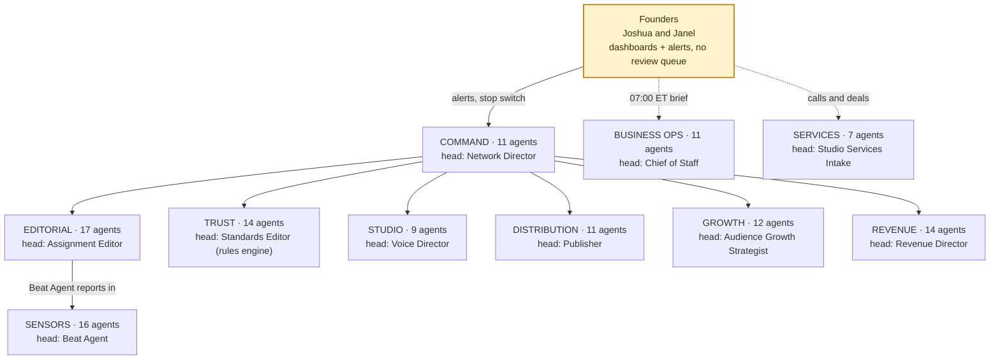

The Network Director heads Command and runs every production run end to end. It wires agents together and makes **no editorial call**. Routing follows `reports_to`: the Beat Agent reports to the Assignment Editor, and Business Ops and Services report straight to the founders.

## 2. One chart per desk

### Command · 11 agents · head: Network Director
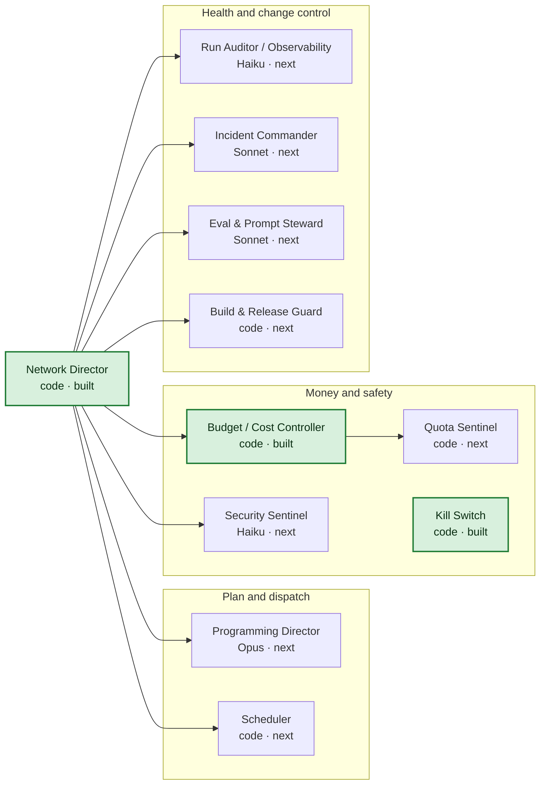
### Sensors · 16 agents · head: Beat Agent
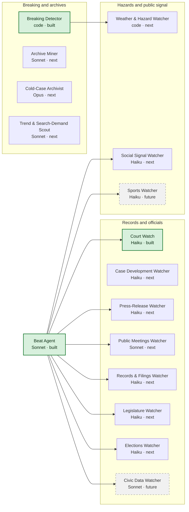
### Editorial · 17 agents · head: Assignment Editor
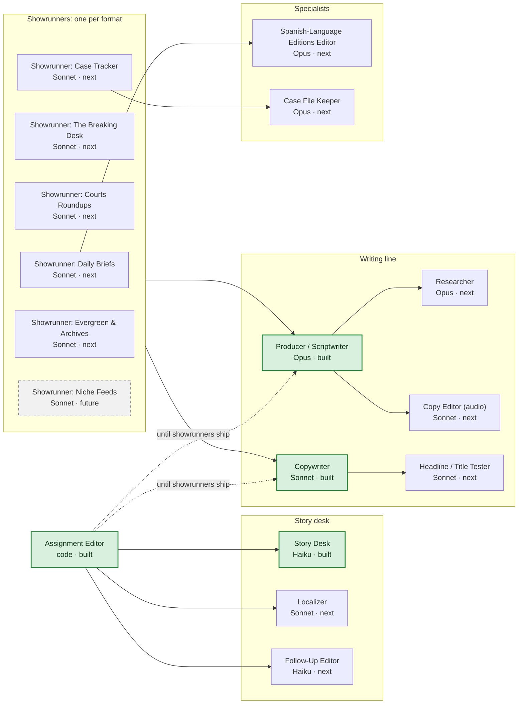
### Trust · 14 agents · head: Standards Editor (rules engine)
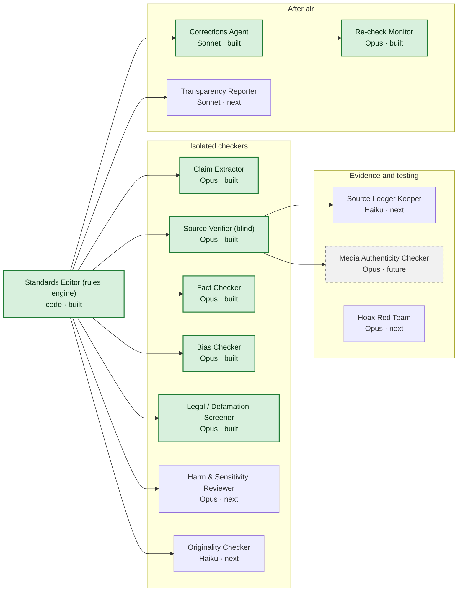
### Studio · 9 agents · head: Voice Director
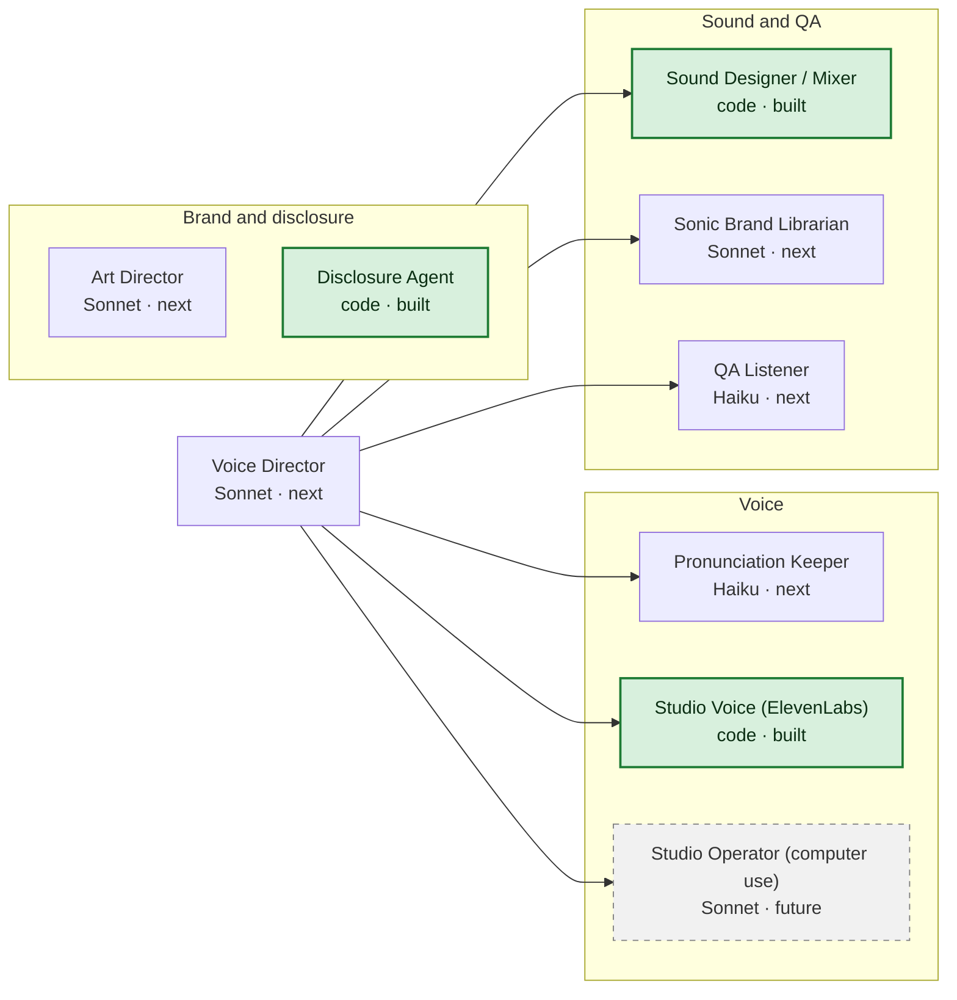
### Distribution · 11 agents · head: Publisher
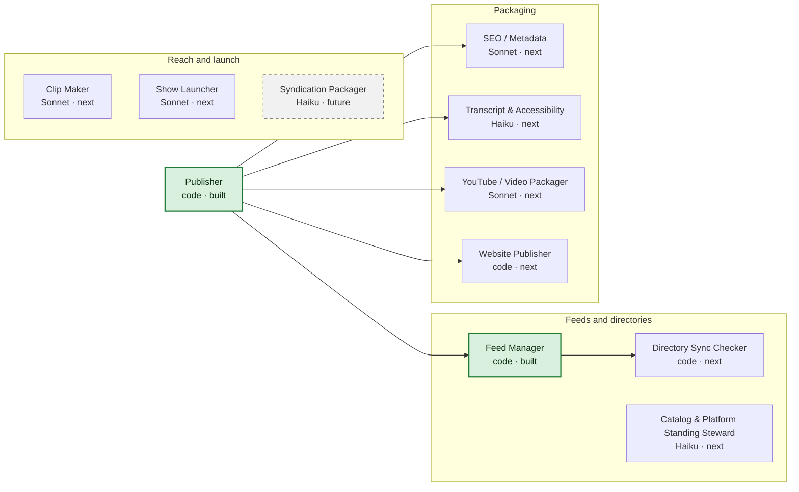
### Growth · 12 agents · head: Audience Growth Strategist
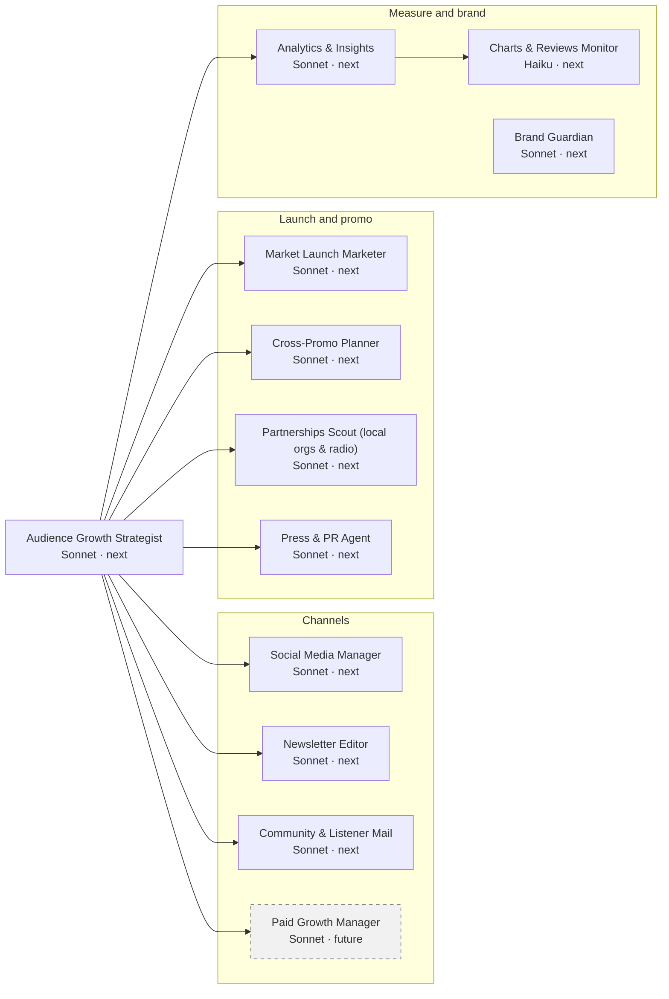
### Revenue · 14 agents · head: Revenue Director
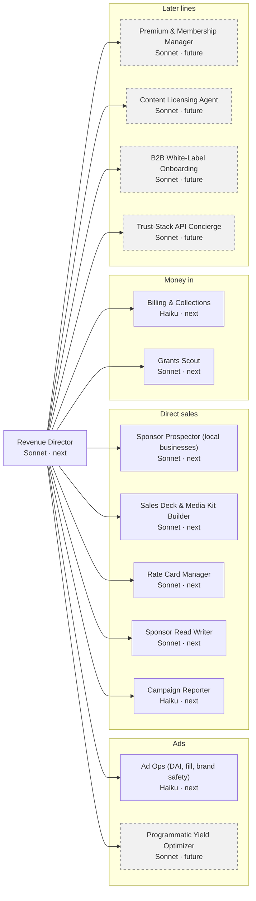
### Business Ops · 11 agents · head: Chief of Staff
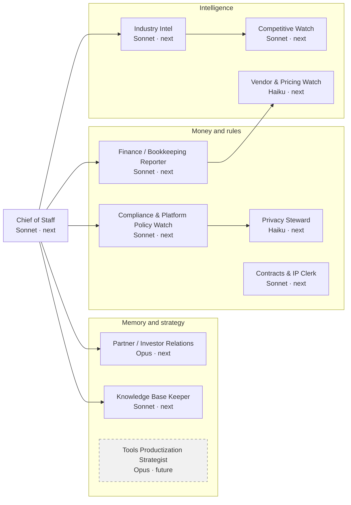
### Services · 7 agents · head: Studio Services Intake
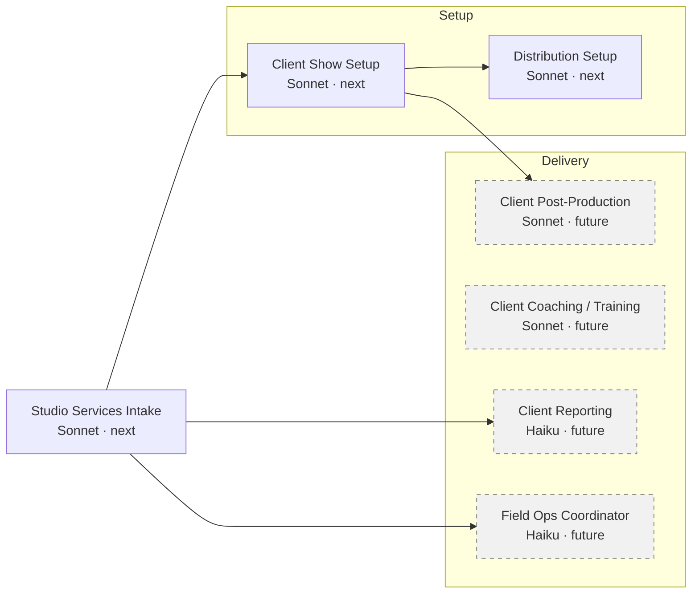

## 3. How one episode moves between desks

```mermaid
flowchart LR
  subgraph IN["Listen and plan"]; SEN["Sensors<br/>Beat Agent, Court Watch"]; SD["Story Desk"]; AE["Assignment Editor<br/>show + lane"]; end
  subgraph WR["Write"]; PR["Producer<br/>+ Researcher, Copy Editor"]; DA["Disclosure Agent<br/>AI outro, last line"]; CX["Claim Extractor"]; end
  subgraph TS["Trust Stack: separate calls, fail closed"]; SV["Source Verifier<br/>blind to writer's sources"]; FC["Fact Checker"]; BC["Bias Checker"]; LS["Legal Screener"]; end
  GATE{"Standards Editor<br/>gate.py, plain code"}
  subgraph OUT["Voice and publish"]; CW["Copywriter"]; STU["Studio<br/>voice, mix, QA"]; PUB["Publisher + Feed Manager"]; end
  LIVE(["Live episode"])
  RC["Re-check Monitor<br/>7 days"]; CA["Corrections Agent"]; LOG["Trust log<br/>nothing airs"]
  SEN -->|"Signal"| SD -->|"Story"| AE -->|"Story list + lane"| PR
  PR -->|"Script"| DA -->|"Script + outro"| CX
  CX -->|"Script + full claim list"| SV & BC & LS & FC
  SV -.->|"page URLs only"| FC
  SV -->|"VerifierReport"| GATE
  FC -->|"FactCheckReport"| GATE
  BC -->|"BiasReport"| GATE
  LS -->|"LegalReport"| GATE
  GATE -->|"PUBLISH: GateDecision"| STU & CW
  STU -->|"MP3 + duration"| PUB
  CW -->|"Copy"| PUB
  GATE -->|"REWRITE (max 2, breaking 1): rewrite_instructions"| PR
  GATE -->|"HOLD (breaking only): re-check in 15 min"| SV
  GATE -->|"KILL: reason logged"| LOG
  PUB -->|"Episode"| LIVE --> RC -->|"Correction"| CA -->|"fixed notes, feed, audio"| PUB
```

- **Contracts are code.** The named arrows (`Signal`, `Story`, `Script`, the four reports, `GateDecision`, `Copy`, `Episode`, `Correction`) are dataclasses in [`earlobe/schemas.py`](../../earlobe/schemas.py), documented in [`json-contracts.md`](json-contracts.md). All four gate exits are one `GateDecision`; only PUBLISH reaches the studio.
- **Every agent call also writes an `AgentRun`** (tier, tokens, cost) that the Budget Controller adds up. The Kill Switch is checked before sensing, voicing and publishing.
- **The Copywriter runs after PUBLISH,** so it can never promise a fact the gate cut. The Network Director wires these steps; it decides nothing.

## 4. Desk table

| Desk | Head | Purpose | Agents | Built / Next / Future | Opus / Sonnet / Haiku / code |
|---|---|---|---|---|---|
| **Command** | Network Director | Dispatch, money, safety switches, health, change control | 11 | 3 / 8 / 0 | 1 / 2 / 2 / 6 |
| **Sensors** | Beat Agent | Turn feeds, releases, dockets and records into Signals | 16 | 3 / 11 / 2 | 1 / 5 / 8 / 2 |
| **Editorial** | Assignment Editor | Signals to a finished script: cluster, assign, research, write | 17 | 4 / 12 / 1 | 4 / 10 / 2 / 1 |
| **Trust** | Standards Editor (rules engine) | Isolated checkers plus a code gate; also product 2 | 14 | 8 / 5 / 1 | 9 / 2 / 2 / 1 |
| **Studio** | Voice Director | Gated scripts to broadcast audio, AI voices disclosed | 9 | 3 / 5 / 1 | 0 / 4 / 2 / 3 |
| **Distribution** | Publisher | Get every episode everywhere; keep the catalog clean | 11 | 2 / 8 / 1 | 0 / 4 / 3 / 4 |
| **Growth** | Audience Growth Strategist | Launches, social, newsletters, community, analytics | 12 | 0 / 11 / 1 | 0 / 11 / 1 / 0 |
| **Revenue** | Revenue Director | Ad ops, local sponsors, billing, grants; memberships later | 14 | 0 / 9 / 5 | 0 / 11 / 3 / 0 |
| **Business Ops** | Chief of Staff | Founders' brief, intel, books, compliance, contracts | 11 | 0 / 10 / 1 | 2 / 7 / 2 / 0 |
| **Services** | Studio Services Intake | C&C Studio Services: in-person podcast setup for clients | 7 | 0 / 3 / 4 | 0 / 5 / 2 / 0 |
| **Total** | | | **122** | **23 / 82 / 17** | **17 / 61 / 27 / 17** |

Head = the desk agent that reports up to the Network Director or the founders and has the desk beneath it *(inference; the Beat Agent is the exception, see section 5)*. Opus tier writes, checks and researches; Sonnet tier runs most of the business; Haiku tier classifies and screens; code decides and moves files.

## 5. Who talks to whom

| Rule | What it means in practice |
|---|---|
| **Reporting carries instructions, not approvals** | `reports_to` sets whose instructions an agent follows and whose KPIs roll up. It never adds a human step to an episode. The Network Director has 15 direct reports. Seven agents report straight to the founders: Network Director, Kill Switch, Chief of Staff, Contracts & IP Clerk, Product Strategist, Services Intake, Client Coaching. |
| **Writers and checkers meet only through the gate** | The Producer hears only the gate's `rewrite_instructions`, never a checker's raw report. The one channel the other way is a context note (`notes_for_checkers`) that only the Bias Checker and Legal Screener read. A rewrite cannot reset its own revision count or move to an easier lane. |
| **Checker isolation** | Source Verifier is blind to the writer's sources. Bias Checker and Legal Screener see the script and that note, nothing else. The Fact Checker sees the script plus only the page URLs the verifier used, never its verdicts. No checker sees another's opinion or its own earlier report, so every pass starts fresh. |
| **Only code decides** | The Standards Editor (`gate.py`) turns four reports into one `GateDecision`: PUBLISH, REWRITE, HOLD (breaking only) or KILL. Same reports, same answer. A checker that errors stops the run (fail closed). No override exists, for anyone. |
| **Gated content only** | Studio voices PUBLISH scripts only. Growth, Distribution and Revenue use gated content only. Standards beat sales: no revenue agent can overrule the Standards Editor. |
| **Sensors listen, never publish** | They write `Signal` records. Signals are untrusted text (the Security Sentinel screens them), and tier-4 items such as social posts are leads, never proof. |
| **Command stops, never edits** | Kill Switch, Budget Controller and Incident Commander can stop or skip a run. They make no editorial call. |
| **19 cross-desk lines** | Six Showrunners, Trend Scout, Show Launcher and Catalog Steward report to the Programming Director. Beat Agent, Case Development Watcher, Breaking Detector, Archive Miner and Cold-Case Archivist report into Editorial. Disclosure Agent reports to the Standards Editor, Art Director to the Brand Guardian, Clip Maker to the Social Media Manager, Syndication Packager to the Content Licensing Agent. Hoax Red Team reports to the Eval Steward, so the Trust desk does not grade itself *(inference)*. |
| **Founders see dashboards and alerts, not a review queue** | They get the 07:00 ET brief from the Chief of Staff (published, stopped, trust, money, decisions), yes/no lines that each carry a default and a deadline, any real legal threat within the hour (Contracts & IP Clerk), and sponsor and Studio Services calls. They can pull the Kill Switch. They never approve, edit or push an episode. |

## 6. Instance math

A **role** is one roster entry (122, fixed). An **instance** is one running copy. *Standing* instances are loops that run all day, such as the Columbia Beat Agent. *Per-run* instances exist for one episode, story or job, then stop. "One per X" in the roster is counted per X; "single agent, one config per X" counts once. This is a model, not a forecast *(inference)*.

| | Today (wave 0, built only) | Wave 0 staffed (built + N1-N4) | Wave 1 (built + next) | Scale (all 122) |
|---|---|---|---|---|
| Markets live (+ national) | 2 (+1) | 2 (+1) | 4 (+1) | 24 (+1) |
| Scheduled shows (`shows.yaml`) | 7 | 7 | 9 | 29 |
| Roles switched on | 23 | 93 | 105 | 122 |
| **Standing instances** | **16** | **87** | **151** | **~540** |
| Scheduled episodes per week | 21 | 21 | 31 | 131 |
| Per-episode instances | 13.5 | 26.5 | 26.5 | 26.5 |
| **Per-run instances per week** | **~280** | **~560** | **~820** | **~3,470** |
| Sum of per-show daily caps | $49 | $49 | $59 | ~$159 |

- **Standing math** (Wave 0 / Wave 1 / Scale). Per market + national (Beat Agent, Weather & Hazard, Social Signal, Elections, Social Media, Newsletter): 3 / 5 / 25 each. Per market (Press-Release, Records & Filings, Localizer, Partnerships Scout, Sponsor Prospector, Competitive Watch, Showrunner: Daily): 2 / 4 / 24 each. Court Watch: 3 / 5 / 25. Legislature Watcher: 5 / 19 (14 new states in the next 20 markets). Public Meetings Watcher: 17 / 97 (9 named bodies in Columbia and LA, about 4 per new market *(inference)*). Spanish editions: 1 / 5. Everything else counts once. N5 roles (Records, Localizer, Legislature, Public Meetings and others) switch on at Wave 1, so the first two columns leave them out.
- **Per-run math.** One episode = 10 per-episode workers (Producer, Copy Editor, Copywriter, Disclosure Agent, Studio Voice, Sound Designer, QA Listener, Publisher, Transcript & Accessibility, Clip Maker) + about 6 Researchers + 7 isolated checker calls × about 1.5 script passes *(inference)*. Today it is 6 workers + 5 checker calls × 1.5. Weekly = episodes × per-episode. Breaking flashes, re-checks and business loops are extra.
- **Money.** Caps are ceilings from [`config/budgets.yaml`](../../config/budgets.yaml), not forecasts. The network cap is $60 a day (the Breaking Desk may still run after it). Wave 1 caps already sum to $59, so there is no headroom for another show. Scale (new dailies at the $5 default *(inference)*) needs a founders' yes/no on a bigger envelope. Costs as of Oct 2026 — verify before buying.
- **Left out of Scale.** The 17 future roles count once each (a per-market Sports Watcher would add up to 25), plus niche feeds (63 ideas in the catalog), Spanish-edition episodes and extra courts roundups.
