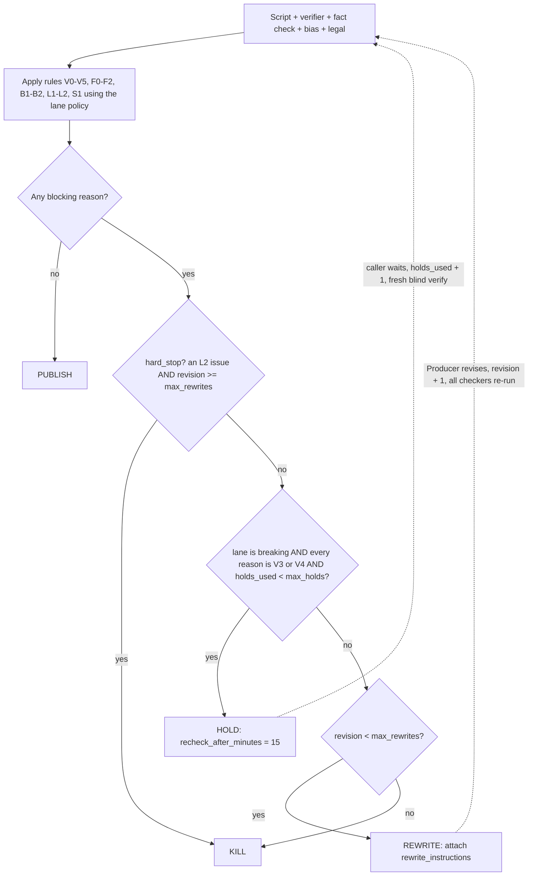

# Trust Gate: the Standards Editor

**Status:** `built` · **Code:** [`earlobe/trust/gate.py`](../../earlobe/trust/gate.py), [`earlobe/schemas.py`](../../earlobe/schemas.py) · **Rulebook:** [editorial standards](../standards/editorial-standards.md) · **Contracts:** `schemas.py` and `json-contracts.md`, changed together ([CONVENTIONS](../CONVENTIONS.md) rule 8) · **As of Oct 2026**

> Nothing goes to the voice studio unless plain code, not a model, says `PUBLISH`.

| | |
|---|---|
| **What it does** | Reads the script plus four JSON reports (verifier, fact checker, bias checker, legal screener). Applies 14 fixed rules. Returns `PUBLISH`, `REWRITE`, `HOLD` or `KILL`. |
| **Why it matters** | It is the only editor. No person reads a script before it airs, and no override forces publication (AUTO-2). |
| **What it costs** | $0 and milliseconds per decision. The checkers upstream carry the cost: a baseline 7-minute brief is about $2.00 in Claude work, the verifier alone $1.04 with 20 searches (F-LLM-07). As of Oct 2026, verify before buying. |

## 1. Why the gate is deterministic

Models **find** things (claims, sources, slant, risk). Code **decides**. Same inputs, same decision, every time.

| Question | A model as judge | The gate (code) |
|---|---|---|
| Same input twice? | May differ | Identical decision |
| Can a script or web page talk it into a yes? | Yes (prompt injection, flattery) | No. It reads enums and numbers. Free text is only copied into fix strings |
| Can we explain a decision? | "The model felt fine" | Rule ids, lane, thresholds, stored with every decision (AUTO-3) |
| How do we test and change it? | Fuzzy evals; re-prompt and hope | Unit tests; change one number in `POLICIES`, docs change the same day (standards section 18) |

Why this matters here *(inference)*: we have no Section 230 shield for our own scripts (F-LEGAL-11), and AI-assistant news answers show a high error rate (about 45% had a significant issue, EBU/BBC Oct 2025; low-medium confidence, F-AUD-07). A fixed, logged process is what we can defend. Records are kept at least 3 years (F-LEGAL-08).

Model output is also treated as **testimony**. The verifier says "3 sources"; code recounts owners from `config/owners.yaml`, collapses wire copy, drops tier 4, and can only *downgrade* the status.

## 2. What each checker sees (blindness)

| Component | Tier | Sees | Never sees | What code does with it |
|---|---|---|---|---|
| **Claim Extractor** (`claims.py`) | Opus | Title and spoken lines | Writer's claim list and sources | Merges with the writer's list: stricter type wins, risk flags are unioned, `attributed` stays true only if both passes agree; missed claims are added with no sources |
| **Source Verifier** (`verifier.py`) | Opus + web search | Claim **id and text only**, market and time zone, episode date | Writer's sources, notes, script lines, lane, other reports | Cleans URLs, maps outlets to owner groups, **recomputes** `independent_count` and `has_official`, downgrade-only status; a conflicting tier-1 source forces `contradicted`. Up to 20 searches per call, 8 claims per call |
| **Fact Checker** (`factcheck.py`) | Opus + web search | Lines, claims (type, flags, attributed), and only **URL + outlet + tier** of pages the verifier used | Verifier's status, counts, notes, `supports` flags | One rating per claim; a repeated id keeps the harshest rating. Up to 15 searches |
| **Bias Checker** (`bias.py`) | Sonnet | Lines, claims, writer's notes (labelled unverified) | Sources and every other report | Score clamped to 0-100. Issues are never filtered, so a sloppy `line_id` still reaches the gate |
| **Legal Screener** (`legal.py`) | Opus | Lines, claims with risk flags, writer's notes | Sources and every other report | Issues never filtered (a hard stop with a bad `target_id` must still count) |
| **Gate** (`gate.py`) | none | Claim ids, types, flags, `attributed`; line `segment`; `revision`; lane; the four reports | Nothing it has to interpret | Applies the rules below |

**Why blind:** a checker that sees the writer's sources tends to confirm them. **Order** (`trust/loop.py`): extract claims, then verifier, bias and legal in parallel, then fact check (it needs the verifier's URLs), then the gate. If any checker raises, nothing publishes (fail closed). The loop owns `revision` and the lane, so a rewrite cannot reset its budget or switch to an easier lane, and it re-appends the disclosure segment if a rewrite dropped it.

## 3. Lane policy

The lane is set per show in `config/shows.yaml`. Values are exactly `POLICIES` in `gate.py` (unlisted fields use the `LanePolicy` defaults).

| Field | `standard` | `strict` | `breaking` | `archive` | Default |
|---|---|---|---|---|---|
| `min_independent` (owner groups) | 2 | 2 | **3** | 2 | 2 |
| `official_satisfies` (one tier-1 record is enough) | yes | yes | **no** | yes | yes |
| `allow_attributed_single` (1 source, said on air, non-sensitive) | yes | **no** | **no** | yes | yes |
| `sensitive_needs_official` | no | **yes** | **yes** | no | no |
| `min_balance` | 70 | **75** | 70 | **65** | 70 |
| `legal_block_severity` | high | **medium** | **medium** | high | high |
| `max_rewrites` | 2 | 2 | **1** | 2 | 2 |
| `max_holds` x `hold_minutes` | 0 x 15 | 0 x 15 | **6 x 15** | 0 x 15 | 0 x 15 |
| **Shows** | Columbia Daily, LA Daily, NYC Daily, Chicago Daily | LA Courts, Case Tracker, Cold Case Files | The Breaking Desk | History of Hollywood | |

Fixed sets in code (all lanes):

- `NEEDS_CORROBORATION` claim types: fact, number, quote, attribution, allegation, legal_status. `prediction` needs attribution (V5); `context` is not checked.
- A claim is **sensitive** if its type is `allegation` or `legal_status` (`SENSITIVE_TYPES`) or it carries a flag in `SENSITIVE_FLAGS`: crime, legal_proceeding, named_private_person, minor, victim, death. Other flags (health, election, breaking, financial) do not change the gate.
- `HARD_STOP_RISKS` (legal): naming_minor, naming_victim.

## 4. Rule catalog

Every rule appends a `GateReason(rule_id, detail, target_id)` and, when it has one, a fix string. All reasons block. "T" marks **threshold** reasons (V3, V4): "not enough independent sources yet", the only kind a breaking `HOLD` may wait out.

| Rule | Fires when | Target | Emitted fix (template) | T |
|---|---|---|---|---|
| **V0** | Claim needs corroboration and the verifier has no finding for it | claim | `Drop or re-source claim {id}: "{text}" (no verification on file).` | |
| **V1** | Verifier status `contradicted` | claim | `Correct or remove {id}: "{text}". Evidence: {note or 'see verifier report'}` | |
| **V2** | Verifier status `unsupported` | claim | `Remove {id}: "{text}" (unsupported).` | |
| **V3** | Status is `corroborated` or `single_source` but none of the three passes below holds. Detail: `{n} independent source(s); policy '{lane}' needs {min}` | claim | `Find more independent sourcing for {id} or cut it: "{text}".` | T |
| **V4** | Claim passed V3, is sensitive, lane has `sensitive_needs_official`, and `has_official` is false | claim | `Back {id} with a court record or official statement, or cut it.` | T |
| **V5** | Claim type `prediction` with `attributed` false | claim | `Attribute the prediction in {id} to a named source or cut it.` | |
| **F0** | Claim needs corroboration and the fact checker has no rating for it | claim | `Re-run fact check for {id}.` | |
| **F1** | Rating `inaccurate` or `misleading` (any claim type) | claim | The checker's `suggested_fix`, else `Fix wording of {id}: {issue}` | |
| **F2** | Rating `unverifiable` (any claim type) | claim | `Remove or soften {id}.` | |
| **B1** | `balance_score` < lane `min_balance` | none | `Rebalance: ` + missing perspectives joined by `; ` (or `neutralize framing`) | |
| **B2** | Any bias issue with severity `high` (one reason per issue) | line | The checker's `suggestion`, else `Rewrite line {id} neutrally.` | |
| **L1** | Legal issue (not a hard-stop risk) with severity at or above the lane's `legal_block_severity` | claim or line | The checker's `fix`, else `Fix legal issue in {target}.` | |
| **L2** | Legal issue with risk `naming_minor` or `naming_victim`, **any severity, every lane** | claim or line | The checker's `fix`, else `Remove identifying details in {target}.` | |
| **S1** | No script line has `segment == "disclosure"` | none | `Append the standard AI disclosure outro (Disclosure agent).` | |

**The three ways a claim passes V3** (`_corroborated` plus the single-source clause):

| Pass | Condition |
|---|---|
| Enough owners | status `corroborated` and `independent_count >= min_independent` |
| Official record | `official_satisfies` and `has_official` and status is `corroborated` or `single_source` |
| Attributed single | `allow_attributed_single` and claim not sensitive and `attributed` and status `single_source` |

Consequences: in `breaking` an official record alone never passes (3 owners needed), and a sensitive claim also needs `has_official` (V4). In `strict` there is no single-source path at all. `minor_issue` ratings, `medium` and `low` bias issues, `low` legal issues, and `medium` legal issues in the standard and archive lanes emit nothing.

## 5. Decision algorithm



- **`PUBLISH`**: no blocking reason. Only this lets the publish step run (`publish/hosts.py` refuses anything else).
- **`REWRITE`**: fixable. `rewrite_instructions` carries every fix string in rule order. Standard, strict, archive: revisions 0 and 1 rewrite, revision 2 is killed. Breaking: revision 0 only.
- **`HOLD`**: breaking only. Looks real, not confirmed enough. The revision does **not** change. 6 holds x 15 min = 90 min; the 7th check cannot hold, so it rewrites or kills.
- **`KILL`**: still blocked after the budget, or an `L2` hit at the last revision. The episode does not air.

## 6. Scores

Logged with every decision (AUTO-3) and shown in the trust log. Rules decide; only `balance_score` is also a threshold (B1).

- `corroboration_rate` = claims that cleared V3 and V4 / claims of corroborated types (3 decimals; 1.0 if none).
- `accuracy_rate` = ratings `accurate` or `minor_issue` / ratings that are not `unverifiable` (1.0 if none).
- `balance_score` = the bias score, passed through (0-100, higher is better). `claims` = count of all claims.

## 7. Worked example: Columbia Daily, 2 claims, REWRITE then PUBLISH

Show `columbia-daily` (lane `standard`), episode 2026-10-12. Ids shortened. The gate outputs were produced by running the real `gate.decide` on these inputs.

**Pass 0 (revision 0), reports in:**

```json
{
  "claims": [
    {"id": "clm_1", "type": "fact", "attributed": false,
     "text": "Richland County Council approved a $12 million road repair budget 7 to 4"},
    {"id": "clm_2", "type": "number", "attributed": false,
     "text": "About 41 percent of county roads are rated poor."}],
  "verifier": [
    {"claim_id": "clm_1", "status": "corroborated", "independent_count": 2, "has_official": true},
    {"claim_id": "clm_2", "status": "single_source", "independent_count": 1, "has_official": false}],
  "factcheck": [
    {"claim_id": "clm_1", "rating": "accurate"},
    {"claim_id": "clm_2", "rating": "misleading", "issue": "Figure comes from a 2023 survey but is worded as current.",
     "suggested_fix": "Based on the county's 2023 road survey, 41 percent of roads were rated poor, the county said."}],
  "bias": {"balance_score": 82, "issues": []}, "legal": {"issues": []}
}
```

**Gate decision (trimmed):**

```json
{
  "decision": "REWRITE", "lane_policy": "standard", "revision": 0,
  "reasons": [
    {"rule_id": "V3", "target_id": "clm_2", "detail": "1 independent source(s); policy 'standard' needs 2"},
    {"rule_id": "F1", "target_id": "clm_2", "detail": "rated misleading: Figure comes from a 2023 survey ..."}],
  "rewrite_instructions": [
    "Find more independent sourcing for clm_2 or cut it: \"About 41 percent of county roads are rated poor.\".",
    "Based on the county's 2023 road survey, 41 percent of roads were rated poor, the county said."],
  "scores": {"corroboration_rate": 0.5, "accuracy_rate": 0.5, "balance_score": 82, "claims": 2}
}
```

Why: `clm_1` has 2 owners, so it passes. `clm_2` has one source, no official record and no attribution, so none of the three V3 passes holds; the fact checker also caught a stale figure (F1).

**Pass 1 (revision 1).** The Producer rewrites `clm_2` to name the county and the year; `clm_1` is unchanged. Everything re-runs from scratch, and the blind verifier now finds the county's road survey (tier 1):

```json
{
  "claims": [{"id": "clm_2", "type": "number", "attributed": true,
              "text": "Based on the county's 2023 road survey, 41 percent of roads were rated poor, the county said."}],
  "verifier": [{"claim_id": "clm_2", "status": "single_source", "independent_count": 1, "has_official": true}],
  "factcheck": [{"claim_id": "clm_2", "rating": "accurate"}], "bias": {"balance_score": 84, "issues": []}
}
```

Gate: `{"decision": "PUBLISH", "revision": 1, "reasons": [], "scores": {"corroboration_rate": 1.0, "accuracy_rate": 1.0, "balance_score": 84, "claims": 2}}`. `clm_2` passes by the official-record route (the attributed-single route would pass too).

## 8. Newsroom rules mapped to gate rules

Classic newsroom and journalism-school rules (SPJ-style: seek truth, minimize harm, act independently, be accountable). The mapping is our reading *(inference)*; standards ids are in [editorial-standards.md](../standards/editorial-standards.md).

| Newsroom rule | Gate rule | Standards | Notes |
|---|---|---|---|
| Two independent sources; wire copy and echoes count once | **V3** | SRC-1 to SRC-5 | 2 owner groups, 3 in breaking. Counted in verifier code, not by the model |
| Primary documents beat accounts of them | **V3** `official_satisfies`, **V4** | SRC-6, SRC-7, SRC-9 | Sensitive claims need a record in strict and breaking |
| Verify everything checkable | **V0**, **F0** | ACC-2, ACC-3 | No finding means blocked |
| Run nothing you know is wrong | **V1**, **V2**, **F1** | ACC-4 to ACC-6 | |
| Say exactly what the record says (arrested is not charged) | **F1**, **F2**, **L1** | ACC-11, ATT-4 | Fact Checker judges wording; Legal flags presumption of innocence |
| Attribute who said it; no unattributed predictions | **V3** (attributed path), **V5**, **F1** | ATT-1 to ATT-5, NUM-9 | If `attributed` is true but no line names the speaker, the Fact Checker rates it misleading and F1 fires |
| Presumption of innocence; no uncharged suspects | **V4**, **L1**, **B2** | FAIR-4, FAIR-5 | |
| Fairness and right of reply | **B1**, **B2** | FAIR-1 to FAIR-3 | `one_sided`, `missing_perspective` |
| No speculation, loaded words, sensationalism | **B2** | NEVER-1, FAIR-2 | |
| Minimize harm: minors and sexual-assault victims | **L2** | NEVER-2, NEVER-3 | Any severity, every lane |
| Privacy and copyright | **L1** | NEVER-5, COPY-1 | Blocks at the lane's severity |
| Do not pretend to be human; disclose AI | **S1**, **L1** (`other`) | VOICE-3, NEVER-7 | S1 checks only that a disclosure line exists |
| In breaking news, wait rather than guess | **HOLD** on V3/V4 | BRK-2 to BRK-6 | |
| No anonymous sources; public corrections; no pay for coverage | **Not the gate** | ANON, AUTO-4 to AUTO-7, COI | Verifier prompt (tier 4 never counts), `monitor/` and `Correction` records, sponsor rules (partly **L1**) |

## 9. Known gaps (read before relying on it)

Observed in the code on 2026-10-12. Standards section 17 lists the checks already proposed (S2 to S6, V6 to V9, C1; all `next`, not built), for example S1 checks presence but not position (NE-1) and the attributed-single path ignores source tier (NE-5).

| # | Observation | Effect | Suggested fix *(inference)* |
|---|---|---|---|
| 1 | `legal=None` is treated as an empty report | A caller that forgets the Legal Screener gets no L1/L2 | The loop always passes one. The API must make `legal` required |
| 2 | `hard_stop` is set only when `revision >= max_rewrites`, the same moment the fall-through already kills | An L2 hit at revision 0 gets a REWRITE ("remove the name"), not an instant KILL. It still can never publish | Founders decide: keep (saves good stories) or kill at once |
| 3 | HOLD tests `policy.name == "breaking"`, not `max_holds > 0` | A custom policy with holds but another name never holds | Test `max_holds` |
| 4 | V0, V1, V2 are not threshold reasons | In breaking, a contradicted or source-less claim gets REWRITE, not HOLD (the contradicted case is tested) | Probably right for V1; revisit V2 for fresh stories |
| 5 | Verifier and fact-checker free text is copied into `rewrite_instructions` | Web-sourced text reaches the Producer prompt | Treat as untrusted input there |

## 10. From gate to sellable Trust Stack API (`future`)

**Pitch.** "A verdict you can explain to your lawyer": claim extraction, blind verification and a deterministic, rule-id decision as a service. Product 2 in the [agent catalog](agent-catalog.md); onboarding by the Trust-Stack API Concierge (`future`). The gate is a pure function of its inputs, so it ships two ways:

- `POST /v1/review`: full stack (extract, blind verify, fact check, bias, legal, gate). Async job; cost is dominated by the verifier and its searches (F-LLM-07, F-LLM-04).
- `POST /v1/gate`: **gate only**. The customer brings their own checker reports; we apply the lane rules. Synchronous, near-zero cost to serve.
- `POST /v1/claims`, `POST /v1/verify`: extraction only, blind verification only. `GET /v1/cases/{id}`: stored decision, reports and policy snapshot.

**Request sketch (`/v1/review`):**

```json
{
  "script": {"title": "Council budget vote", "episode_date": "2026-10-12",
             "lines": [{"id": "ln_1", "speaker": "host", "segment": "body", "text": "Richland County Council approved a 12 million dollar road repair budget Tuesday, 7 to 4."},
                       {"id": "ln_2", "speaker": "host", "segment": "disclosure", "text": "This episode was written and voiced using AI."}]},
  "lane": "standard", "market": {"name": "Columbia, SC", "tz": "America/New_York"},
  "case_id": null, "webhook_url": "https://customer.example/hooks/trust"
}
```

**Response sketch** (same shape as `GateDecision`, plus an audit block):

```json
{
  "case_id": "case_01", "decision": "REWRITE", "lane_policy": "standard", "revision": 0,
  "reasons": [{"rule_id": "V3", "target_id": "clm_2", "blocking": true,
               "detail": "1 independent source(s); policy 'standard' needs 2"}],
  "rewrite_instructions": ["Find more independent sourcing for clm_2 or cut it: \"...\"."],
  "scores": {"corroboration_rate": 0.5, "accuracy_rate": 1.0, "balance_score": 82, "claims": 2},
  "recheck_after_minutes": null,
  "audit": {"rule_pack": "illustrative-2026.10", "policy": {"min_independent": 2, "min_balance": 70},
            "input_sha256": "...", "report_sha256": {"verifier": "...", "bias": "..."},
            "checker_tiers": {"verifier": "opus", "bias": "sonnet"}}
}
```

**What changes between the in-house gate and the API** *(all inference)*:

| Change | Why |
|---|---|
| Server owns `revision`, `holds_used` and the lane, keyed by `case_id` | Today the caller passes them; a customer could reset a budget or pick an easier lane |
| `legal` required in strict and breaking; close gaps 1, 5 and the section 17 items; settle gap 2 | The API cannot rely on a caller doing the right thing |
| Versioned **rule pack** and policy snapshot in every response; customer **policy profiles** tune thresholds inside bounds, but `L2` and the disclosure rule stay on | A customer must reproduce an old decision exactly, and we do not sell a rubber stamp |
| Never label output "verified" unless the decision is `PUBLISH`; return the rule ids that blocked it | The Concierge watches for customers using output to make false content look checked |
| Golden tests per rule (Eval & Prompt Steward, `next`); keep cases at least 3 years (F-LEGAL-08); say plainly the Legal Screener is a checklist, not legal advice | Regression safety, liability and trust |

**Price.** Not set. The cost model's API rate of $500 to $3,000 is **UNSUPPORTED** in the facts-sheet audit ("Model assumptions"); treat it as a hypothesis and test it with 2 or 3 buyers. Unit-cost anchors are F-LLM-07 and F-LLM-04 (as of Oct 2026, verify before buying).
